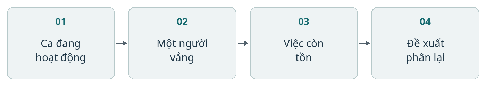
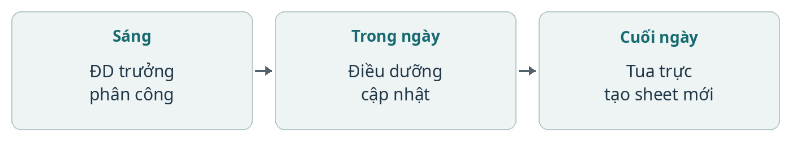
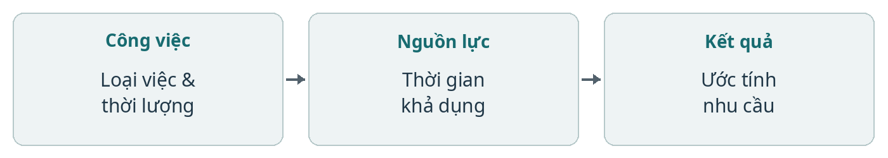
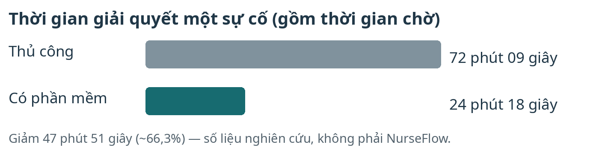
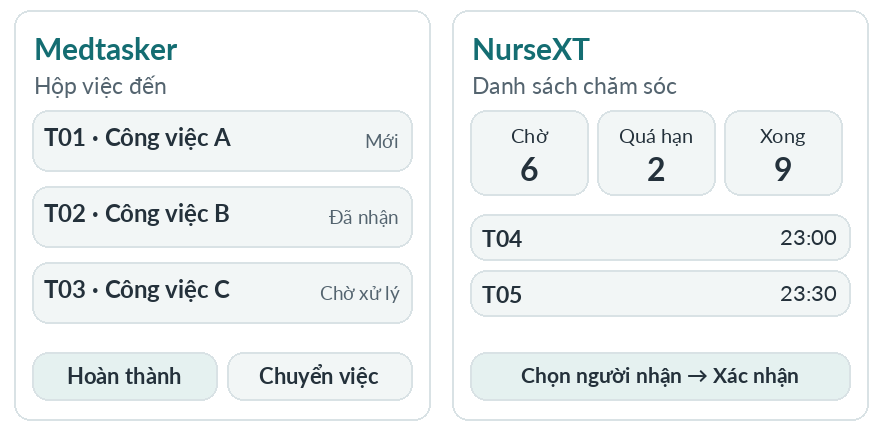
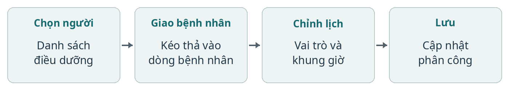
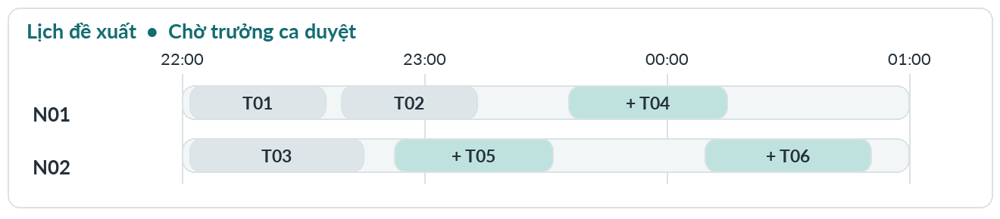
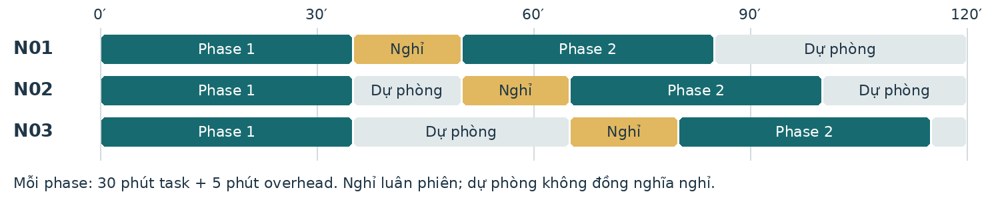

**01 / TỔNG QUAN & PHẠM VI**

# Báo cáo khảo sát NurseFlow

Nhóm Tôi Yêu Vingroup • Track B – Healthcare • Discovery / CP2

**Mục tiêu:** Tìm hiểu cách bệnh viện giao việc cho điều dưỡng, xử lý vắng người đột xuất và những phần mềm hỗ trợ hiện có. Báo cáo dựa trên tài liệu công khai, không phải khảo sát do nhóm trực tiếp thực hiện.

## Lát cắt CP1 đã chốt \[1\]

Trong một ca đang diễn ra, một điều dưỡng vắng đột xuất. Trưởng ca cần chuyển các công việc còn tồn hoặc sắp đến hạn sang người còn khả dụng, đủ kỹ năng. Đây là lát cắt CP1; định hướng Problem – Gap – Solution mở rộng về tối ưu tải và nghỉ theo phase được phân tích ở trang 11–13.

## Ba cấp phân việc – không được nhầm lẫn

| **Cấp**             | **Ví dụ**                              | **Phạm vi NurseFlow**                      |
|---------------------|----------------------------------------|--------------------------------------------|
| Xếp lịch trực       | Ai làm ca ngày, ca đêm?                | Không lập lại cả lịch trực.                |
| Phân công bệnh nhân | Ai phụ trách phòng / bệnh nhân P01?    | Thông tin nền để giữ trách nhiệm chăm sóc. |
| Phân công công việc | Ai nhận việc T01, trong khung giờ nào? | Trọng tâm: chuyển việc bị ảnh hưởng.       |

Hình 1. Lát cắt sản phẩm đề xuất, không phải quy trình đã khảo sát tại bệnh viện.

## Kết luận nhanh

An Giang có ví dụ phân việc theo buồng bệnh; Phần Lan có quy trình tìm nhân lực thay thế; Australia có hệ thống quản lý từng task. Các nguồn hỗ trợ các phần khác nhau của bài toán, không chứng minh mọi bệnh viện đều phân việc giống nhau.

**Nguồn:** [\[1\]](https://github.com/lit1numyt/K5-Day15-L3B-ToiYeuVingroup/blob/main/canvas.md) · [\[2\]](https://thuvienphapluat.vn/van-ban/The-thao-Y-te/Thong-tu-31-2021-TT-BYT-hoat-dong-dieu-duong-trong-benh-vien-499198.aspx) · [\[3\]](https://bvag.com.vn/wp-content/uploads/2023/11/Ky-yeu-khoa-hoc-ky-thuat.pdf#page=593) · [\[5\]](https://www.utupub.fi/items/dbf432c1-7db5-4c9f-914a-043c6e51d85a) · [\[10\]](https://medinform.jmir.org/2021/8/e28245)

**02 / QUY TRÌNH NGHIỆP VỤ**

# Việt Nam: phân việc trong khoa

## Bệnh viện Đa khoa Trung tâm An Giang \[3\]

Sáng kiến tại khoa Ngoại tổng hợp (kỷ yếu 2023) mô tả việc chuyển bảng phân công chăm sóc hằng ngày từ giấy sang Google Sheets. Tài liệu ghi rõ ai cập nhật và thời điểm cập nhật.

| **Thời điểm** | **Ai thực hiện**       | **Cách làm được mô tả**                                      |
|---------------|------------------------|--------------------------------------------------------------|
| Buổi sáng     | Điều dưỡng trưởng khoa | Phân công trên bảng tính; thông tin tổ chức theo buồng bệnh. |
| Trong ngày    | Điều dưỡng bệnh phòng  | Cập nhật thay đổi như ra viện, hội chẩn.                     |
| Cuối ngày     | Tua trực               | Cập nhật bệnh mới vào phòng tương ứng; tạo sheet ngày sau.   |

Hình 2. Dựng lại quy trình trong sáng kiến An Giang, tr. 593.

Trước cải tiến, phải chép lại thông tin mỗi ngày, khó chia sẻ, khó theo dõi liên tục. Sau cải tiến, tác giả báo cáo việc cập nhật thuận tiện hơn và giảm ghi chép; không nêu số phút tiết kiệm cụ thể. \[3\]

## Quy định và mô hình chăm sóc \[2\]

Điều 13 giao trách nhiệm phân công, điều phối cho điều dưỡng trưởng khoa; người phụ trách từng ca tùy cách tổ chức của đơn vị. Điều 6 yêu cầu bàn giao vấn đề theo dõi/chăm sóc và ghi phiếu chăm sóc.

| **Mô hình**     | **Hiểu đơn giản**                                     |
|-----------------|-------------------------------------------------------|
| Chăm sóc chính  | Một điều dưỡng giữ trách nhiệm chính với người bệnh.  |
| Theo đội / nhóm | Các thành viên phối hợp chăm sóc một nhóm người bệnh. |
| Theo công việc  | Các nhiệm vụ được chia theo loại công việc.           |

**Giới hạn:** Chưa rõ khoa An Giang có chuyển từng task khi vắng người hay không; tài liệu không mô tả sự cố này. Không suy rộng cho mọi bệnh viện.

**Nguồn:** [\[2\]](https://thuvienphapluat.vn/van-ban/The-thao-Y-te/Thong-tu-31-2021-TT-BYT-hoat-dong-dieu-duong-trong-benh-vien-499198.aspx) · [\[3\]](https://bvag.com.vn/wp-content/uploads/2023/11/Ky-yeu-khoa-hoc-ky-thuat.pdf#page=593)

**03 / BẰNG CHỨNG KHẢO SÁT**

# Việt Nam: đo tải công việc

## Nghiên cứu WISN tại 4 bệnh viện tỉnh \[4\]

Nguyen, Phung và Bui (2022) nghiên cứu 22 khoa tại Bắc Giang, Thanh Hóa, Cần Thơ, Đồng Tháp với dữ liệu 2015–2018. Có 132 điều dưỡng trả lời bảng hỏi bán cấu trúc và 22 cuộc thảo luận nhóm. Nghiên cứu đo nhu cầu nhân lực theo công việc (WISN).

| **Các bước nghiên cứu** | **Dữ liệu thu thập**                                                 |
|-------------------------|----------------------------------------------------------------------|
| 1\. Xem hồ sơ nhân sự   | Số người, thời gian làm việc khả dụng, nghỉ.                         |
| 2\. Hỏi về hoạt động    | Công việc chuyên môn, hành chính và hoạt động khác.                  |
| 3\. Quan sát thời lượng | Mỗi hoạt động được quan sát tối thiểu 10 lần để ước tính thời lượng. |
| 4\. Tính nhu cầu        | So tải công việc, thời gian khả dụng với nhân lực hiện có.           |

## Số liệu có thể dùng cho evidence

| **Chỉ số**                    | **Kết quả**                                     |
|-------------------------------|-------------------------------------------------|
| Khoa thiếu 1–2 điều dưỡng     | 10/22 khoa = 45,5% (theo abstract).             |
| Khoa khác thiếu 5 người       | Một khoa tại Cần Thơ được abstract mô tả riêng. |
| Thời gian dành cho hành chính | Khoảng 20–40% tổng thời gian làm việc.          |

Hình 3. Tóm tắt phương pháp WISN; không phải thuật toán xếp task của NurseFlow.

## NurseFlow học gì?

Không chỉ đếm số việc hoặc số bệnh nhân. Cần biết thời lượng của việc và khả năng đáp ứng thực tế. Mỗi khoa có thể khác nhau; thời lượng nghiên cứu không được lấy làm định mức chung hoặc dùng để tự tạo y lệnh.

**Giới hạn:** Nghiên cứu đánh giá nhu cầu nhân lực dài hạn, không đo thời gian phân task khi một người rời ca. Phần kết quả và abstract mô tả số khoa thiếu chưa hoàn toàn đồng nhất; dùng đúng nhóm 10/22 thiếu 1–2 người theo abstract, không gọi đó là tỷ lệ thiếu nhân lực toàn quốc.

**Nguồn:** [\[4\]](https://doi.org/10.1186/s12960-021-00668-y)

**04 / QUY TRÌNH THỰC TẾ & EVIDENCE**

# Phần Lan: xử lý thiếu người đột xuất

Tuominen (2020) mô tả công việc của quản lý điều dưỡng trước và sau khi có hệ thống điều phối nhân lực. Đây là nguồn sát nhất với sự kiện thiếu người của NurseFlow, dù đối tượng điều phối là nhân lực thay thế, không phải task chăm sóc. \[5, 6\]

| **Bước**           | **Trước: giấy / liên lạc**                           | **Sau: có phần mềm**               |
|--------------------|------------------------------------------------------|------------------------------------|
| 1\. Nhận tin vắng  | Điện thoại, email, trao đổi.                         | Vẫn nhận thông báo.                |
| 2\. Tìm người thay | Tra bảng giấy ở văn phòng quản lý.                   | Tra nguồn lực trên hệ thống chung. |
| 3\. Xác nhận       | Liên hệ quản lý khoa khác hoặc người dự phòng.       | Giảm nhu cầu gọi, hỏi lại.         |
| 4\. Xử lý          | Tìm người thay hoặc điều chỉnh ca / ghi thiếu người. | Cập nhật phương án nguồn lực.      |

## Kết quả đo thực tế (luận án, hình 8)

| **Chỉ số**              | **Trước (4 tuần)** | **Sau (4 tuần)** |
|-------------------------|--------------------|------------------|
| Sự cố được ghi nhận     | 1.326              | 1.286            |
| Thao tác điều phối      | 4.285              | 1.515            |
| Thao tác/sự cố (xấp xỉ) | 3,2                | 1,2              |

Hình 4. Tính lại từ thời gian công bố tại tr. 52 của luận án. Bao gồm thời gian chờ, không phải toàn bộ thời gian lao động chủ động.

**Giới hạn:** 61 quản lý tham gia; tổng sự cố trong luận án 2.612, bài báo ghi 2.628. Hai số khác nhau; bảng dùng nhất quán số của luận án. Nghiên cứu trước–sau không chứng minh NurseFlow sẽ đạt cùng mức giảm.

**Nguồn:** [\[5\]](https://www.utupub.fi/items/dbf432c1-7db5-4c9f-914a-043c6e51d85a) · [\[6\]](https://pubmed.ncbi.nlm.nih.gov/31652140/)

**05 / THỤY ĐIỂN · SCOTLAND · IRAN · TRUNG QUỐC**

# Các nghiên cứu bổ sung về ca trực

## Thụy Điển – Epstein và cs. (2023) \[7\]

Nghiên cứu phỏng vấn 20 người quản lý và nhân viên điều phối. Khi xây lịch, họ cân nhắc kỹ năng, nhu cầu nghỉ và mong muốn của nhân viên. Khi thiếu người, họ tìm nguồn dự phòng, hỗ trợ từ khoa lân cận hoặc xem xét thay đổi ca theo quy định. Một số nơi cải thiện bàn giao bằng biểu mẫu chuẩn hóa việc đã làm và việc tiếp theo.

Nguồn mô tả thiếu nhân lực làm giảm cơ hội nghỉ trong ca và khó lấp ca đêm. Không mô tả một thuật toán chuyển task cụ thể.

## Scotland – Rankin và cs. (2016) \[8\]

Nghiên cứu bảng hỏi 60 điều dưỡng trưởng (52 phản hồi, theo bản toàn văn) và 12 phỏng vấn. Việc duy trì lịch trực, đảm bảo nhân lực và cơ cấu kỹ năng chiếm thời gian quản lý. Đây là evidence về khó khăn của đúng nhóm vai trò gần với trưởng ca; không cung cấp quy trình task chi tiết.

## Iran – nghiên cứu 1.344 ca trực (2025) \[9\]

Nghiên cứu quan sát ghi nhận 117/1.344 ca (8,7%) lệch lịch dự kiến. Trong 98 ca vắng điều dưỡng RN/RN+ (gồm cả ca vắng đồng thời trợ lý), 21 ca có RN tạm thời bổ sung; 57,1% không ghi nhận bổ sung nhân lực. Điều đó không đồng nghĩa không có điều chỉnh nội bộ.

## Trung Quốc – phân việc dưới tải cao (2026) \[18\]

Phỏng vấn 27 người tại 7 bệnh viện tuyến cao, nghiên cứu về cảm nhận công bằng khi chia việc. Kết quả gợi ý xét tải thực tế, hỗ trợ linh hoạt, quy tắc phân công rõ và nghỉ ngơi. Chưa có căn cứ mô tả quy trình chi tiết của từng bệnh viện từ abstract.

| **Insight cho NurseFlow**               | **Hàm ý**                                  |
|-----------------------------------------|--------------------------------------------|
| Không phải lúc nào cũng có người thay   | Cho phép trả kết quả thiếu nguồn lực.      |
| Kỹ năng và nghỉ ngơi ảnh hưởng lựa chọn | Không phân chỉ dựa trên số việc còn trống. |
| Bàn giao phải rõ trách nhiệm            | Cho thấy việc còn tồn và người nhận.       |

**Nguồn:** [\[7\]](https://doi.org/10.1155/2023/8096034) · [\[8\]](https://onlinelibrary.wiley.com/doi/full/10.1111/jonm.12330) · [\[9\]](https://pmc.ncbi.nlm.nih.gov/articles/PMC12410400/) · [\[18\]](https://pubmed.ncbi.nlm.nih.gov/42894391/)

**06 / MEDTASKER & NURSEXT**

# Phần mềm quản lý từng công việc

Hình 5. Minh họa dựng lại chức năng từ tài liệu, không phải ảnh chụp giao diện thật.

## Medtasker – Northern Hospital, Australia \[10\]

Nhân viên tạo và gửi việc tới người nhận, người nhận tiếp nhận, chuyển tiếp nếu cần và đánh dấu hoàn thành. Hệ thống có thể cảnh báo thêm nhân viên nếu việc chưa được nhận đúng thời gian cấu hình. Nghiên cứu 22 tháng ghi nhận hơn 300.000 task của nhiều vai trò, không chỉ điều dưỡng.

Dữ liệu gồm nhóm người nhận, vai trò người gửi, loại việc, độ khẩn, lịch sử và thời điểm. Học cách hiển thị trạng thái, thời gian nhận việc và cảnh báo.

## NurseXT – Care Tasks \[11\]

Trưởng ca hoặc giám sát giao việc. Nhân viên xem việc đến hạn, việc của mình; mở task để cập nhật tiến độ. Nếu không làm được: mở task, chọn chuyển giao, chọn nhân viên khả dụng, nhập lý do và xác nhận. Các task lặp có thể hình thành từ kế hoạch chăm sóc.

| **Điều đáng học**                                       | **Điều khác với phạm vi NurseFlow**                          |
|---------------------------------------------------------|--------------------------------------------------------------|
| Task có mã, người nhận, hạn, trạng thái và mức ưu tiên. | NurseFlow cần xử lý cả nhóm task bị ảnh hưởng bởi một sự cố. |
| Lịch sử chuyển giao, lý do và xác nhận.                 | Phải rà soát toàn bộ phương án và ràng buộc trước khi duyệt. |

**Giới hạn:** Chưa dùng thử phần mềm; tài liệu không đủ để kết luận đối thủ không có chức năng tối ưu đồng thời.

**Nguồn:** [\[10\]](https://medinform.jmir.org/2021/8/e28245) · [\[11\]](https://docs.nursext.com/using-nursext/care-tasks)

**07 / CLAIRVIA & EPIC**

# Phần mềm phân bổ người chăm sóc

## Clairvia Assignment Manager \[12, 13\]

Tài liệu hướng dẫn Patient Assign mô tả cách giao điều dưỡng cho bệnh nhân. Người dùng mở danh sách nhân viên và người bệnh, chọn điều dưỡng, kéo vào dòng bệnh nhân, chỉnh vai trò / giờ bắt đầu và kết thúc nếu cần, rồi lưu. Hệ thống cập nhật giờ chăm sóc và có thể lưu lịch sử phân công.

Hình 6. Dựng lại luồng thao tác theo hướng dẫn Clairvia, không phải ảnh chụp giao diện.

## Epic Assignment Wizard – Hamilton Health Sciences \[14, 15\]

Case study của Epic mô tả sử dụng điểm nhu cầu chăm sóc để hỗ trợ phân công người bệnh. Nghiên cứu Synergy Model tại Hamilton và Grand River cũng ghi nhận hướng dẫn phân công được xây dựa trên đặc điểm người bệnh và năng lực điều dưỡng. Mục tiêu là tránh chia tải chỉ theo số người bệnh.

| **Sản phẩm** | **Đơn vị phân công**         | **NurseFlow học gì**             |
|--------------|------------------------------|----------------------------------|
| Medtasker    | Task                         | Tiếp nhận, chuyển, cảnh báo.     |
| NurseXT      | Task                         | Hạn, trạng thái, lý do chuyển.   |
| Clairvia     | Bệnh nhân / người chăm sóc   | Mốc thời gian, vai trò, lịch sử. |
| Epic         | Bệnh nhân / nhu cầu chăm sóc | Cân bằng tải dựa vào nhu cầu.    |

Định vị theo CP1: điều phối lại các task còn tồn sau sự cố vắng mặt, có ràng buộc và trưởng ca duyệt. Đối chiếu định hướng mở rộng về tải, overhead và nghỉ theo phase tại trang 11–13; chưa xác minh tính năng độc quyền.

**Nguồn:** [\[12\]](https://myschedule.kfshrc.edu.sa/ClairviaWeb/Help/Content/Assigning-Caregivers-to-Patients.htm) · [\[13\]](https://myschedule.kfshrc.edu.sa/ClairviaWeb/Help/Content/Patient-Assign-Overview.htm) · [\[14\]](https://www.epicshare.org/global/equitable-data-driven-staffing) · [\[15\]](https://pmc.ncbi.nlm.nih.gov/articles/PMC8128426/)

**08 / AS-IS → TO-BE**

# Tổng hợp quy trình & thiết kế đề xuất

Luồng AS-IS dưới đây là tổng hợp tham chiếu từ An Giang, Thông tư 31, nghiên cứu Phần Lan và tài liệu sản phẩm; chưa phải quy trình đã xác nhận tại khoa mục tiêu.

| **Giai đoạn**  | **Người phụ trách / thao tác**                                                                                    |
|----------------|-------------------------------------------------------------------------------------------------------------------|
| Đầu ca         | Nhận bàn giao, kiểm tra người bệnh, nhân lực, phân công trách nhiệm.                                              |
| Trong ca       | Thực hiện việc đã chỉ định; ghi tiến độ, cập nhật thay đổi.                                                       |
| Khi vắng người | Xác định phần việc bị ảnh hưởng; kiểm tra người khả dụng, năng lực và nhu cầu; phân lại hoặc báo thiếu nguồn lực. |
| Cuối ca        | Cập nhật tình trạng và bàn giao việc còn lại.                                                                     |

Hình 7. Wireframe đề xuất: lịch công việc theo điều dưỡng; dữ liệu giả lập, không phải phần mềm bệnh viện thật.

## Luồng NurseFlow theo lát cắt CP1 (đề xuất)

Chọn ca → báo vắng và thời điểm → xem task còn tồn → tạo bản nháp → kiểm tra và duyệt. Nếu thiếu dữ liệu, người dùng bổ sung; nếu không có phương án khả thi, báo rõ lý do và yêu cầu trưởng ca xử lý.

| **Dữ liệu UI cần có** | **Ý nghĩa**                                                   |
|-----------------------|---------------------------------------------------------------|
| Task                  | Mã, người bệnh giả lập, thời lượng, hạn, kỹ năng, trạng thái. |
| Điều dưỡng            | Mã, lịch việc, kỹ năng, giờ nghỉ và khả dụng.                 |
| Kết quả               | Ai nhận việc nào, lúc nào, việc chưa phân được, lý do.        |

## Ví dụ minh họa: N03 rời ca lúc 23:00

| **Việc còn lại**          | **Kết quả nháp (giả lập)**                     |
|---------------------------|------------------------------------------------|
| T01 – hạn 23:30           | N01 nhận nếu đủ kỹ năng và không trùng lịch.   |
| T02 – hạn 00:00           | N02 nhận nếu còn khả dụng.                     |
| T03 – yêu cầu kỹ năng S02 | Chưa phân được nếu không còn người đủ kỹ năng. |

Coverage = duy trì đủ nguồn lực theo yêu cầu đã được xác nhận. Khoảng trống trên lịch không đồng nghĩa có thể nhận thêm việc. Không tự sửa y lệnh; không duyệt phương án vi phạm ràng buộc.

**Nguồn:** [\[1\]](https://github.com/lit1numyt/K5-Day15-L3B-ToiYeuVingroup/blob/main/canvas.md) · [\[2\]](https://thuvienphapluat.vn/van-ban/The-thao-Y-te/Thong-tu-31-2021-TT-BYT-hoat-dong-dieu-duong-trong-benh-vien-499198.aspx) · [\[3\]](https://bvag.com.vn/wp-content/uploads/2023/11/Ky-yeu-khoa-hoc-ky-thuat.pdf#page=593) · [\[5\]](https://www.utupub.fi/items/dbf432c1-7db5-4c9f-914a-043c6e51d85a) · [\[10\]](https://medinform.jmir.org/2021/8/e28245) · [\[11\]](https://docs.nursext.com/using-nursext/care-tasks) · [\[12\]](https://myschedule.kfshrc.edu.sa/ClairviaWeb/Help/Content/Assigning-Caregivers-to-Patients.htm)

**09 / SỐ LIỆU CÓ THỂ KIỂM LẠI**

# Evidence và impact cho CP2

Đây là ví dụ/số liệu từ nghiên cứu thứ cấp, chưa phải log phỏng vấn của nhóm. Cách tính bên dưới lấy đúng tử số và mẫu số đã công bố; không có dữ liệu thô để đếm lại từng sự kiện.

| **ID** | **Số liệu hoặc trích dẫn ngắn**               | **Nguồn / giới hạn**                |
|--------|-----------------------------------------------|-------------------------------------|
| E01    | 1.326 sự cố; 4.285 thao tác trước can thiệp.  | \[5\] hình 8; điều phối nhân lực.   |
| E02    | 1.286 sự cố; 1.515 thao tác sau can thiệp.    | \[5\] hình 8; cùng nghiên cứu.      |
| E03    | 10/22 khoa thiếu 1–2 điều dưỡng = 45,5%.      | \[4\] abstract; Việt Nam.           |
| E04    | “a permanent stressor” (áp lực thường trực).  | \[7\] §3.4.1, Staffing assistant 1. |
| E05    | 117/1.344 ca lệch lịch = 8,7%.                | \[9\] phần Deviations; Iran.        |
| E06    | 21/98 ca vắng RN được bổ sung RN tạm = 21,4%. | \[9\] Table 3 và phần đáp ứng.      |

## Impact sơ bộ – không dùng số giả làm evidence

Công thức: số trưởng ca × số sự cố/tháng/người × số phút xử lý/sự cố. Ví dụ mô phỏng 10 người × 4 sự cố × 15 phút = 600 phút = 10 giờ/tháng. Ba đầu vào chỉ là giả định, không phải số liệu của khoa mục tiêu.

Nguồn Phần Lan cho thấy giảm thời gian xử lý gồm cả chờ khoảng 47 phút 51 giây/sự cố. Chỉ dùng làm tham chiếu; không áp số này trực tiếp vào dự báo tiết kiệm NurseFlow.

## Trạng thái so với yêu cầu BTC \[16,17\]

CP2: đã có số liệu và trích dẫn ban đầu để cập nhật Canvas. CP3: cần ít nhất một nguồn đạt ngưỡng, 5 trích dẫn/ví dụ nguyên văn có nguồn và cách khai thác kiểm lại được. Bảng trên là dẫn chứng công bố; chưa khẳng định đạt R1 vì chưa khai thác dữ liệu cấp bản ghi hoặc thu đủ khảo sát/phỏng vấn của nhóm.

**Nguồn:** [\[4\]](https://doi.org/10.1186/s12960-021-00668-y) · [\[5\]](https://www.utupub.fi/items/dbf432c1-7db5-4c9f-914a-043c6e51d85a) · [\[7\]](https://doi.org/10.1155/2023/8096034) · [\[9\]](https://pmc.ncbi.nlm.nih.gov/articles/PMC12410400/) · [\[16\]](https://github.com/VinUni-AI20k/K5-L3-Day15-AI-Product-Hackathon/blob/main/02-guide.md#b1-2) · [\[17\]](https://github.com/VinUni-AI20k/K5-L3-Day15-AI-Product-Hackathon/blob/main/03-rubric.md)

**10 / BÀN GIAO DISCOVERY**

# Câu hỏi xác minh và nguồn

Các câu hỏi cần xác minh với trưởng ca (hỏi lần gần nhất, không xin tên hoặc hồ sơ người bệnh):

| **Nội dung** | **Câu hỏi**                                                              |
|--------------|--------------------------------------------------------------------------|
| Quy trình    | Khoa phân theo bệnh nhân, phòng hay từng việc? Công cụ đang dùng là gì?  |
| Sự cố        | Lần gần nhất một người rời ca: ai thông báo, ai xử lý, việc nào còn lại? |
| Ràng buộc    | Kỹ năng, thời hạn, nghỉ và yêu cầu coverage được kiểm tra thế nào?       |
| Impact       | Trong tháng qua xảy ra mấy lần, mỗi lần mất bao lâu, kết quả ra sao?     |
| Ngoại lệ     | Nếu không thể chia lại, báo ai hoặc xin hỗ trợ bằng cách nào?            |

## Danh mục nguồn (bấm để mở)

\[01\] [Canvas CP1 – NurseFlow](https://github.com/lit1numyt/K5-Day15-L3B-ToiYeuVingroup/blob/main/canvas.md)

\[02\] [Thông tư 31/2021/TT-BYT, Điều 6, 7, 10, 13](https://thuvienphapluat.vn/van-ban/The-thao-Y-te/Thong-tu-31-2021-TT-BYT-hoat-dong-dieu-duong-trong-benh-vien-499198.aspx)

\[03\] [Kỷ yếu BVĐKTT An Giang (2023), tr. 592–594](https://bvag.com.vn/wp-content/uploads/2023/11/Ky-yeu-khoa-hoc-ky-thuat.pdf#page=593)

\[04\] [Nguyen, Phung & Bui (2022), WISN tại 4 bệnh viện Việt Nam](https://doi.org/10.1186/s12960-021-00668-y)

\[05\] [Tuominen (2020), luận án, bảng 8 tr. 50 và hình 8 tr. 52](https://www.utupub.fi/items/dbf432c1-7db5-4c9f-914a-043c6e51d85a)

\[06\] [Tuominen và cs. (2020), bài báo, PMID 31652140](https://pubmed.ncbi.nlm.nih.gov/31652140/)

\[07\] [Epstein và cs. (2023), mục 3.4.1–3.4.4](https://doi.org/10.1155/2023/8096034)

\[08\] [Rankin và cs. (2016), nghiên cứu senior charge nurses](https://onlinelibrary.wiley.com/doi/full/10.1111/jonm.12330)

\[09\] [Temporary nurse deployments (2025), Table 3 và phần Deviations](https://pmc.ncbi.nlm.nih.gov/articles/PMC12410400/)

\[10\] [Team Dynamics in Hospital Workflows (2021), Medtasker](https://medinform.jmir.org/2021/8/e28245)

\[11\] [NurseXT – Care Tasks, hướng dẫn sử dụng](https://docs.nursext.com/using-nursext/care-tasks)

\[12\] [Clairvia – Assigning Caregivers to Patients](https://myschedule.kfshrc.edu.sa/ClairviaWeb/Help/Content/Assigning-Caregivers-to-Patients.htm)

\[13\] [Clairvia – Patient Assign Overview](https://myschedule.kfshrc.edu.sa/ClairviaWeb/Help/Content/Patient-Assign-Overview.htm)

\[14\] [EpicShare – Equitable, Data-Driven Staffing (Hamilton)](https://www.epicshare.org/global/equitable-data-driven-staffing)

\[15\] [Hamilton & Grand River – Synergy Model (2021)](https://pmc.ncbi.nlm.nih.gov/articles/PMC8128426/)

\[16\] [AI20K Guide, bước 1.2–1.4](https://github.com/VinUni-AI20k/K5-L3-Day15-AI-Product-Hackathon/blob/main/02-guide.md#b1-2)

\[17\] [AI20K Rubric, R1](https://github.com/VinUni-AI20k/K5-L3-Day15-AI-Product-Hackathon/blob/main/03-rubric.md)

\[18\] [Task Allocation Under High Workload (2026), nghiên cứu Trung Quốc](https://pubmed.ncbi.nlm.nih.gov/42894391/)

Bàn giao: dùng trang 2–8 cho spec.md §0/§3; trang 9 cho evidence/summary.md và §2, cập nhật canvas.md dòng 4. Không ghi các nghiên cứu thành phỏng vấn do nhóm thực hiện. Chưa phỏng vấn trực tiếp hay dùng thử phần mềm; ảnh dựng lại; ảnh bảng gốc An Giang không truy xuất được qua công cụ xem PDF.

**11 / PROBLEM · GAP · SOLUTION**

# Đối chiếu bài toán mới

Định hướng do nhóm cung cấp bổ sung: tối ưu cách phân việc trong cả ca, không chỉ xử lý lúc một điều dưỡng vắng. Đây là đề xuất cần thống nhất lại với Canvas CP1, chưa phải phạm vi đã được xác nhận trong repo.

| **Thành phần**       | **Nội dung đề xuất của nhóm**                                                                                                                                                                           |
|----------------------|---------------------------------------------------------------------------------------------------------------------------------------------------------------------------------------------------------|
| Problem – Vấn đề     | Điều dưỡng dễ bị quá tải (overwhelm). Một phần có thể đến từ overhead time, giao case không phù hợp năng lực và các việc nhỏ bị chia rời rạc, khiến khó có khoảng nghỉ rõ ràng.                         |
| Gap – Khoảng trống   | Thay vì chia theo số bệnh nhân hoặc số task, cần xét nhu cầu chăm sóc, thời lượng, vị trí và thời hạn của công việc; đối chiếu với kỹ năng, khả dụng và tải của điều dưỡng.                             |
| Solution – Giải pháp | Gom nhóm bệnh nhân/task và điều dưỡng theo tiêu chí phù hợp; tối ưu tổng tải, cân bằng giữa người làm việc, tổ chức các phase và khoảng nghỉ luân phiên. Ưu tiên giao đúng năng lực; trưởng ca rà soát. |

## Overhead time là gì?

Thời gian phát sinh ngoài việc chăm sóc trực tiếp: di chuyển, tìm dụng cụ, chuẩn bị, chuyển ngữ cảnh, liên lạc và ghi chép. Chỉ giảm phần lãng phí có thể tránh; ghi chép bắt buộc, kiểm tra và bàn giao vẫn phải thực hiện.

| **Giả thuyết**             | **Nguồn đã khảo sát**                                                      | **Mức độ xác nhận**                                                     |
|----------------------------|----------------------------------------------------------------------------|-------------------------------------------------------------------------|
| Tải cao, thiếu nhân lực    | WISN Việt Nam: 10/22 khoa thiếu 1–2 người \[4\].                           | Có bằng chứng về áp lực nhân lực; không đo overwhelm cá nhân.           |
| Overhead làm mất thời gian | WISN: 20–40% thời gian hành chính \[4\]; An Giang giảm ghi chép lặp \[3\]. | Có thành phần gián tiếp; chưa đo overhead có thể tránh.                 |
| Giao việc lệch kỹ năng/tải | Synergy Model \[15\], nghiên cứu Thụy Điển \[7\], Trung Quốc \[18\].       | Có căn cứ xét kỹ năng và tải; chưa có tỷ lệ giao sai tại khoa mục tiêu. |
| Khó nghỉ trong ca          | Thụy Điển \[7\] ghi nhận thiếu người ảnh hưởng cơ hội nghỉ.                | Có bằng chứng định tính; chưa chứng minh chia phase sẽ cải thiện.       |

Kết luận: Problem có cơ sở nghiên cứu, nhưng các nguyên nhân và mức ảnh hưởng tại khoa mục tiêu vẫn cần xác minh. Không coi toàn bộ thời gian hành chính là lãng phí.

**12 / BENCHMARK · KHOẢNG TRỐNG**

# So sánh giải pháp hiện có

So sánh theo đúng solution mới: giao đúng năng lực, cân bằng tải theo thời lượng, giảm overhead và tạo khoảng nghỉ theo phase. Các nhận định dựa trên tài liệu ở trang 2–7, không phải kiểm thử sản phẩm.

| **Nguồn / giải pháp**           | **Đã giải quyết gì?**                                                  | **NurseFlow dự kiến bổ sung**                                                               |
|---------------------------------|------------------------------------------------------------------------|---------------------------------------------------------------------------------------------|
| An Giang \[3\]                  | Bảng phân công theo buồng bệnh; cập nhật hằng ngày bằng Google Sheets. | Dùng vị trí để nhóm task phù hợp; đề xuất lịch có ràng buộc thay vì chỉ hiển thị phân công. |
| WISN Việt Nam \[4\]             | Đo thời lượng hoạt động và nhu cầu nhân lực.                           | Từ đo tải ở cấp khoa sang đề xuất từng task, từng phase trong ca.                           |
| Phần Lan \[5,6\]                | Tìm người thay thế và giảm thao tác điều phối khi vắng người.          | Tập trung vào lịch task của nhân lực hiện hữu; tối ưu lại khi có sự cố.                     |
| Medtasker \[10\]                | Tạo, nhận, chuyển và theo dõi task; cảnh báo.                          | Đề xuất nhiều task đồng thời; xét kỹ năng, tải và chi phí chuyển việc.                      |
| NurseXT \[11\]                  | Quản lý deadline, trạng thái, chuyển giao task.                        | Gom việc tương thích theo phase và bảo vệ khoảng nghỉ nếu khả thi.                          |
| Clairvia \[12,13\]              | Phân người chăm sóc cho bệnh nhân theo thời gian, vai trò.             | Mô hình hóa chi tiết task, thời lượng, overhead và lịch nghỉ.                               |
| Epic / Synergy \[14,15\]        | Cân bằng nhu cầu chăm sóc; xét đặc điểm người bệnh và năng lực.        | Bổ sung lịch task theo phase, chi phí di chuyển/chuyển ngữ cảnh và nghỉ luân phiên.         |
| Thụy Điển / Trung Quốc \[7,18\] | Nghiên cứu nhu cầu về kỹ năng, tải, nghỉ và phân công công bằng.       | Chuyển các tiêu chí này thành ràng buộc và mục tiêu có thể đánh giá.                        |

## Khoảng trống nên phát biểu như thế nào?

Không nên nói chưa có phần mềm nào cân bằng tải hoặc xét kỹ năng: Epic/Synergy và Clairvia đã giải quyết một phần. Khoảng trống nghiên cứu của nhóm là kết hợp các yếu tố trên ở cấp task, với phase và khoảng nghỉ có thể kiểm tra, trong bối cảnh một khoa. Chưa xác minh các đối thủ thiếu chức năng tương đương.

**13 / SOLUTION · MINH HỌA**

# Phân việc theo phase

Luồng đề xuất: nhập task và lịch ca → phân nhóm theo nhu cầu, vị trí, thời hạn → đối chiếu năng lực và khả dụng → tối ưu lịch → rà soát/duyệt. Không thay đổi y lệnh, không hoãn việc cấp thiết để gom nhóm.

## Ví dụ giả lập: 3 điều dưỡng, 12 task trong 120 phút

| **Điều dưỡng** | **Trước: task + overhead** | **Sau: task + overhead** |
|----------------|----------------------------|--------------------------|
| N01            | 90 + 20 = 110 phút         | 60 + 10 = 70 phút        |
| N02            | 60 + 15 = 75 phút          | 60 + 10 = 70 phút        |
| N03            | 30 + 10 = 40 phút          | 60 + 10 = 70 phút        |
| Tổng           | 225 phút                   | 210 phút                 |

Hình 8. Lịch minh họa sau phân việc, không phải kết quả solver. Các task giả định có thời hạn và kỹ năng phù hợp; coverage và nghỉ cần được kiểm chứng.

Ví dụ giả định mỗi task 15 phút; tổng chăm sóc vẫn 180 phút. Overhead giả định giảm 45 → 30 phút, chênh lệch tải 70 → 0 phút. Khoảng nghỉ 15 phút/người chỉ là minh họa, không phải định mức y tế. Không lấp đầy thời gian dự phòng một cách máy móc.

## Đo hiệu quả và giới hạn MVP

| **Chỉ số cần đo**    | **Cách kiểm tra**                                                   |
|----------------------|---------------------------------------------------------------------|
| Tải và overhead      | Max – min tải (phút); tổng phút overhead có thể tránh.              |
| Đúng người, đúng giờ | Số task sai kỹ năng/trễ hạn; kiểm tra không trùng lịch và coverage. |
| Nghỉ thực sự         | Số phút nghỉ được bảo vệ; không tính standby là nghỉ.               |

So với CP1: nên giữ sự cố một người vắng làm kịch bản demo, dùng phase và nghỉ như hướng cải tiến nếu nhóm chốt. Không có phương án đáp ứng ràng buộc thì báo thiếu nguồn lực, không ép xếp lịch. Chưa đo hiệu quả thực tế; các metric/ngưỡng cần chốt cùng nhóm, không sửa chuẩn đã khóa CP2.
