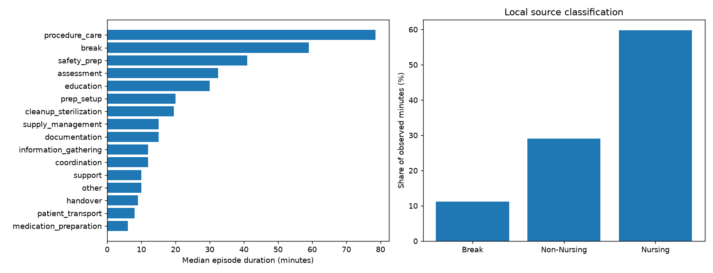
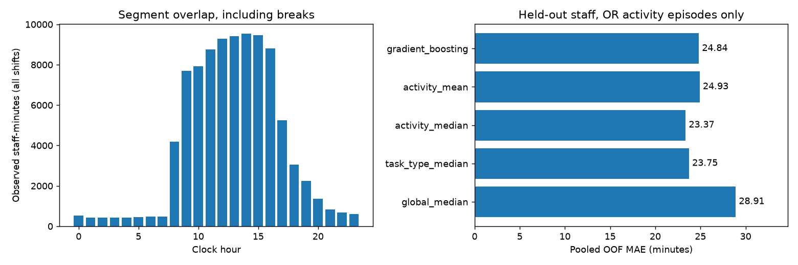

# NurseFlow — Báo cáo Preliminary CP3

## 1. Mục tiêu và lựa chọn dữ liệu

Lam và Kiên thực hiện Preliminary nhằm xác định nguồn dữ liệu, đơn vị thời lượng và feature
phục vụ L3, đồng thời chuẩn bị đầu vào cho bài toán phân công đầu ca tại khoa nội trú.
Kiến trúc và giao diện bàn giao theo thiết kế của Khoa. [Module contract](module-contract.md) · [Feature spec](feature-spec.md).

Nhóm chọn Zenodo 20754938 cho EDA và thực nghiệm thời lượng hoạt động phòng mổ (OR).
Workbook có nhãn hoạt động, thời điểm, thời lượng quan sát và mã nhân viên để chia tập đánh giá.
Với L3 nội trú, nhóm chọn hướng dùng thời lượng đã cung cấp, tra nguồn phù hợp khi đủ điều kiện,
và hỏi bổ sung khi thiếu cơ sở. Bảng Simmons là nguồn tham chiếu thời lượng chăm sóc theo lượt bệnh nhân.
Target được chọn là số phút vì L2 nhận thời lượng để kiểm capacity, deadline và giờ nghỉ.
Zenodo có quan sát thời gian để kiểm target này. Điểm workload cần thêm dữ liệu hiệu chỉnh
trước khi chuyển thành phút cho solver.

| Nguồn | Bằng chứng và vai trò được chọn |
|---|---|
| [Zenodo 20754938](https://zenodo.org/records/20754938) | Quan sát tại một phòng mổ Nhật Bản, tháng 7/2024. Dùng cho EDA và kiểm khả năng dự đoán duration của activity episode. Thiếu liên kết bệnh nhân, acuity/ADL và kinh nghiệm nhân viên. |
| [Simmons et al., Table 3](https://pmc.ncbi.nlm.nih.gov/articles/PMC12303744/) | Chín dòng mean/SD/min/max phút mỗi lượt chăm sóc ở khoa ACE. Dùng làm nguồn lookup tham khảo cho task phù hợp. [Bảng trích](../data/reference/ward_task_duration.csv). |
| [MatchRN](https://zenodo.org/records/15248072) | Staffing, perceived workload và overtime cấp ca. Dùng làm bằng chứng pain. |
| [MIMIC Demo](https://physionet.org/content/mimic-iv-demo/2.2/) và [eICU Demo](https://physionet.org/content/eicu-crd-demo/2.0.1/) | Cung cấp bối cảnh lâm sàng và sự kiện ghi nhận. Các bảng đã kiểm thiếu nhãn phút lao động điều dưỡng phù hợp. |
| [NRP](https://github.com/psmet1/nrp/tree/269a7a302b1c5f59f4938d7e2a26d1421a159a39) | Tham khảo roster, skill/level, shift và coverage nhiều ngày. Cần chọn ngày, ca và người có mặt khi tạo instance. |
| [McGill](https://doi.org/10.5683/SP4/L1ZBLT) | Công cụ taxonomy/workload với 113 item và patient-mark trống. Tổng điểm item 218, footer 219. Chưa có phép quy đổi điểm thành phút được xác minh. |

Các nguồn bổ sung được sàng lọc theo mức khớp bài toán, khả năng truy cập và công sức chuẩn bị.
Southampton D2876 có metadata nhưng link tệp trả HTTP 401 khi kiểm. NAS mới xác minh metadata.
Các nghiên cứu tại Alexandra Hospital và 13 khoa nội–ngoại ở Ý cung cấp dữ liệu chi tiết theo yêu cầu.
SONAR thuộc bối cảnh nursing home và cần xử lý dữ liệu sensor/HAR. Hollingsworth được dùng để đối chiếu
định nghĩa task và độ biến thiên. Chi tiết nguồn, phiên bản, quyền sử dụng và mức kiểm chứng được lưu
trong catalogue. [Catalogue nguồn](../data/reference/preliminary_sources.json) · [Data card](../data/DATA_CARD.md).

## 2. Xử lý và kiểm soát chất lượng dữ liệu

Quy trình tiếp nối bản dịch và EDA ban đầu của Kiên tại commit `153d463`.

1. Đối chiếu workbook với MD5 công bố `78e04eb6c4ffcf2b599afd3080f97c21` và giữ số dòng Excel để truy nguồn.
2. Bỏ một dòng trùng nguyên vẹn, giữ thứ tự trong từng staff-shift và mã ca gốc. Khi qua 0h, kiểm đoạn trước nối đúng đoạn sau rồi cập nhật ngày.
3. Dịch nhãn, giữ nghĩa hoạt động. Chuẩn bị thuốc được nhóm thành `medication_preparation`, vận chuyển thành `patient_transport`, thu thập thông tin thành `information_gathering`.
4. Gộp segment cùng nhãn liền nhau trong cùng staff-shift thành một activity episode. Tổng phút sau gộp phải bằng tổng phút segment.
5. Giữ thiếu giờ kết thúc ca ở trạng thái unknown, overtime trống là `Unspecified`. Cờ `is_preparation_activity` phản ánh category chuẩn bị của nguồn.
6. Tạo bảng feature từ episode làm việc. Trước EDA, đối chiếu ID, nhân viên, ngày, dòng nguồn, nhãn và duration giữa hai bảng để phát hiện dữ liệu trung gian cũ. CSV dùng xuống dòng LF để giữ checksum nhất quán khi lưu trên Git.

Các episode là khoảng hoạt động liên tục. Workbook thiếu mã bệnh nhân và ca mổ để tách một
khoảng hoạt động thành từng task của một bệnh nhân. Các outlier được giữ để phản ánh độ biến thiên.

Qua kiểm tra phần trích xuất của Kiên, nhóm xác định các giới hạn khi tái sử dụng nguồn phụ.
eICU ghi y lệnh và hồ sơ theo dõi. Acuity/ADL dẫn xuất bằng rule và cờ toàn đợt điều trị có thể
chứa thông tin sau thời điểm đầu ca. Bảng ghép theo giờ và các hệ số duration tự đặt chưa có
liên kết quan sát để kiểm định. NRP có Schedule/ScheduleLocks cho kịch bản vắng, hai bộ có giờ
lệch 60 phút và JobTime đã trừ break. Những đặc điểm này cần được xử lý khi xây dựng kịch bản.

Trong roster NRP Normal, Emergency chỉ có 1/27 người mang mã skill 175.
Geriatrics có 4/21 người mang mã 186 và 20/21 người mang mã 187. Một người có thể
mang nhiều mã. Các số này cho biết kỹ năng hiếm trong roster toàn kỳ. Coverage theo ca
còn phụ thuộc người có mặt và mức kỹ năng của từng người.

## 3. Feature và schema bàn giao

Bảng `l3_activity_features.csv` có một dòng cho mỗi episode làm việc, gồm 10 cột.

| Trường | Kiểu/đơn vị | Cách sử dụng |
|---|---|---|
| `episode_id`, `source_excel_rows` | Chuỗi ID, mảng số dòng Excel mã hóa JSON | Định danh và truy nguồn quan sát. |
| `staff_id` | Chuỗi | Chia nhóm train/test theo nhân viên. |
| `date` | Ngày ISO YYYY-MM-DD | Metadata phiên quan sát và kiểm theo thời gian. |
| `task_name` | Categorical | Feature được chọn cho bảng tra median trong OR. |
| `nurseflow_task_type`, `task_category` | Categorical | Nhóm dẫn xuất từ nhãn, dùng tổng hợp và đối chứng ở độ chi tiết khác. |
| `actual_duration_min` | Số thực, phút | Target của episode liên tục. |
| `target_kind`, `source_dataset` | Chuỗi mô tả | Ghi đơn vị quan sát và nguồn dữ liệu. |

Trong tập làm việc có 45 tên hoạt động, 15 nhóm task và 12 category. Mỗi tên xác định một
nhóm và một category trong workbook. Chọn tra theo tên giữ thông tin chi tiết với cách triển khai
đơn giản. ID, thời điểm kết thúc thực tế và kết quả phân công chỉ phục vụ truy nguồn hoặc đánh giá.
Acuity, ADL, qualification và experience cần quan sát liên kết trước khi sử dụng làm feature L3.
Các cột categorical có cardinality thấp nên dùng one-hot encoding cho model đối chứng, fit riêng
trên train để xử lý nhãn mới khi đánh giá. Bảng tra giữ trực tiếp nhãn hoạt động. Nhóm loại staff ID
khỏi feature để tránh học thuộc nhân viên và giữ timestamp kết thúc ở vai trò kiểm tra target.

Với L3 nội trú, bảng Simmons hỗ trợ lookup theo task. Bốn tên khớp các ví dụ ở feature-spec là
`med_admin`, `vitals`, `wound_care` và `mobilization`. Năm ví dụ còn thiếu thời lượng task tương ứng
là `hygiene`, `admission`, `discharge`, `handover`, `documentation`. Năm dòng bổ sung trong CSV
chỉ áp dụng khi công việc đúng định nghĩa nguồn. Cần phân biệt `procedure_care` của OR
(scrub/circulating nursing) với treatments/procedures ở ACE.

Nghiên cứu Simmons gồm 145 giờ, 438 lượt chăm sóc ở một khoa ACE tại Mỹ, 96% quan sát vào ca ngày.
Các số gộp chưa hỗ trợ hiệu chỉnh theo acuity hoặc ca đêm. Toileting và mobility có trường hợp
cần hai staff. Mobility chỉ gồm chuyển giường–ghế và hỗ trợ đi lại. Việc xác nhận điều kiện thực hiện
và staffing là đầu vào cần thiết trước khi dùng lookup.

| Tình huống | Hướng bàn giao theo contract |
|---|---|
| Có duration hợp lệ | Giữ số phút đầu vào và `duration_source=given`. |
| Thiếu duration, công việc và điều kiện khớp nguồn | Đề nghị tra mean Simmons, làm tròn lên phút nguyên và ghi `lookup:simmons-2025-table3`. Ví dụ kỹ thuật cho `vitals`, 3,65 → 4 phút. |
| Loại việc chưa rõ hoặc chỉ có mốc ghi hồ sơ | L1 trả `need_info` với các trường cần bổ sung. |
| Có đủ roster, skills, coverage, cửa giờ và duration | Chuyển cùng instance cho L2 lập lịch, validator kiểm ràng buộc và L4 so baseline. |

Hướng lookup là quyết định của phần dữ liệu để trình tích hợp L3 với Tiệp và Khoa.
Đã đối chiếu lại bản McGill gốc từ Borealis, checksum khớp nguồn. Tệp chỉ có một sheet,
113 item chấm điểm và phần đánh dấu bệnh nhân trống. Một mô tả wound care có điều kiện
trên 15 phút; đây là điều kiện của item, chưa cung cấp phép đổi mọi điểm workload thành phút.
Simmons Table 3 công bố mean/SD/range theo lượt chăm sóc. Vì vậy bản cập nhật nguồn trong
contract §3.3 dùng Simmons cho duration có điều kiện, còn McGill hỗ trợ taxonomy/workload.
[McGill gốc](https://borealisdata.ca/api/access/datafile/1247255?format=original) · [Simmons, Table 3](https://agsjournals.onlinelibrary.wiley.com/doi/10.1111/jgs.19507?af=R).
Quy tắc làm tròn là lựa chọn kỹ thuật để nạp solver. Độ chính xác tại khoa đích cần được đánh giá
bằng thời lượng quan sát tương ứng. Trên bản sao fixture F01, T1 mang `vitals`, 4 phút và nguồn
lookup đã qua kiểm cấu trúc, được xếp trong `[0, 4)` và validator trả `valid=true`.

### Bộ dữ liệu để các module làm song song

Nhóm bàn giao thêm `data/preliminary/instances.json` với ba ca kỹ thuật có khai báo
`data_kind=synthetic`. Các ca có đủ roster/skill/level, patient acuity/ADL, task/cửa giờ,
capacity, coverage và nghỉ. P01 có duration đã cho, P02 có cặp input/expected cho lookup,
P03 loại N3 do vắng. Các giả định có trong metadata; chúng phục vụ kiểm giao diện, tách
khỏi dữ liệu quan sát cho train/eval. Checker xác nhận đủ trường và mỗi ca có lịch
chứng minh khả thi qua validator hiện tại. Lookup OR theo tên cũng được xuất riêng.
Ba ca tập trung vào giao diện core; fixture CP2 hỗ trợ thêm tình huống kỹ năng hiếm,
deadline, nghỉ và từ chối. Phase, equipment, preparation và precedence còn thuộc bước
kiểm triển khai sản phẩm CP3.
[Hướng dẫn từng người nhận và lệnh chạy](../data/preliminary/README.md).

<!-- EDA_RESULTS -->

## 4. Kết quả EDA

Dữ liệu raw có 11,074 segment, tổng 92,718 phút.
Sau bỏ 1 dòng trùng còn 11,073 segment,
92,708 phút, 2,380 activity episode của
37 nhân viên trong 168 staff-shift. Có
46 nhãn, 13 category và 9 lượt qua 0h.

### 4.1. Phân phối và dữ liệu thiếu

| Nhóm hoạt động | Số episode | Trung vị (phút) | P95 (phút) | Outlier |
| --- | --- | --- | --- | --- |
| prep_setup | 480 | 20.0 | 57.05 | 21 |
| procedure_care | 430 | 78.5 | 251.65 | 11 |
| cleanup_sterilization | 354 | 19.5 | 66.35 | 19 |
| handover | 211 | 9.0 | 22.5 | 29 |
| break | 188 | 59.0 | 70.3 | 46 |
| coordination | 167 | 12.0 | 114.7 | 18 |
| information_gathering | 125 | 12.0 | 66.2 | 11 |
| patient_transport | 103 | 8.0 | 19.8 | 7 |
| documentation | 95 | 15.0 | 41.2 | 6 |
| education | 85 | 30.0 | 122.4 | 4 |
| supply_management | 49 | 15.0 | 73.2 | 3 |
| assessment | 26 | 32.5 | 206.75 | 3 |
| other | 25 | 10.0 | 58.0 | 2 |
| support | 21 | 10.0 | 156.0 | 3 |
| medication_preparation | 15 | 6.0 | 24.0 | 1 |
| safety_prep | 6 | 41.0 | 50.5 | 0 |

Outlier là giá trị nhỏ hơn Q1 − 1,5 × IQR hoặc lớn hơn Q3 + 1,5 × IQR của từng nhóm task.
[Thống kê đầy đủ mean, SD, max và p95](../data/processed/duration_by_type.csv).
Nhóm hiếm nhất là safety_prep với 6 episode, medication_preparation có 15 episode.
Cần xét quy mô từng nhóm khi đọc các giá trị median và p95.

Ở mức segment, 840 dòng thiếu giờ kết thúc ca.
Ở mức episode có 205 dòng thiếu.
Có 10,534 dòng raw trống overtime được giữ
là Unspecified. Bảng feature chọn được các cột có dữ liệu liên kết đầy đủ.
Acuity/ADL ↔ duration chưa tính được do thiếu liên kết bệnh nhân.
[Số thiếu và tỷ lệ từng bước](../data/processed/missingness.csv).



Nhãn Nursing/Non-Nursing/Break theo phân loại địa phương của nguồn. Tổng staff-minutes theo giờ
được tính từ phần giao của segment với từng giờ và bằng 92,708 phút.
Trong 2,192 lượt bắt đầu hoạt động làm việc, khung
09h–10h có nhiều nhất, 331 lượt trong tuần.
Muốn suy nhu cầu theo giờ còn cần mẫu số nhân lực và bệnh nhân.

### 4.2. Đánh giá thời lượng

Đánh giá trên 2,192 episode làm việc với 5 folds
GroupKFold theo staff. Encoder, bảng tra và model được fit trên train của từng fold.
MAE/RMSE/R² được tính gộp từ dự đoán out-of-fold. Khi gặp nhãn mới, bảng tra dùng thống kê
tương ứng trên toàn train. Boosting dùng ba cột categorical, seed 42 và cấu hình cố định.

| Phương pháp | MAE (phút) | RMSE (phút) | R² |
| --- | --- | --- | --- |
| global_median | 28.9147 | 57.1798 | -0.1238 |
| task_type_median | 23.7493 | 45.9343 | 0.2748 |
| activity_median | 23.3668 | 45.1922 | 0.298 |
| activity_mean | 24.9268 | 44.0337 | 0.3336 |
| gradient_boosting | 24.835 | 43.9702 | 0.3355 |

Median theo tên đạt MAE 23.37 phút,
trung vị sai số tuyệt đối 10 phút. Nhóm procedure_care có
430/2192 episode và đóng góp
50.8% tổng sai số tuyệt đối.
Boosting đạt RMSE 43.97 phút,
so với 44.03 phút của mean theo tên.
[Sai số từng nhóm task](../data/processed/l3_metrics_by_type.csv) · [Dự đoán OOF](../data/processed/l3_oof_predictions.csv).



Nhóm thử thêm median fallback theo nhóm task, boosting tối ưu MAE và boosting trên log-duration.
Các phương án được kiểm bằng cùng các fold theo staff và một phép chia riêng tại 00h ngày
13/7/2024. Episode băng qua mốc được loại khỏi phép kiểm theo thời gian. Bảng kết quả cho thấy
median phân cấp chỉ cải thiện rất nhỏ, còn thứ hạng model thay đổi trên mẫu cuối tuần.
[Kết quả các phương án](../data/processed/duration_options_metrics.csv) · [Fold và checksum](../data/processed/duration_options_summary.json).

## 5. Kết luận và phạm vi áp dụng

Nhóm chọn median theo task_name làm baseline duration cho thí nghiệm OR vì cách tra đơn giản
và MAE cạnh tranh trên các cấu hình đã kiểm. Hai cột nhóm được giữ để tổng hợp và đối chứng.
Kết quả phụ thuộc cách chia và cơ cấu mẫu, đặc biệt mẫu cuối tuần nhỏ. Workbook thiếu mã ca mổ
và bệnh nhân để kiểm độc lập theo hai đơn vị đó. Chia theo staff vẫn có thể chứa các hoạt động
cùng bối cảnh ở hai phía train/test. Phạm vi đánh giá hiện tại là một bệnh viện trong một tuần.

Với bài toán nội trú của NurseFlow, nhóm chọn given/lookup có nguồn cho L3. Việc học ảnh hưởng
của acuity, ADL và kinh nghiệm cần thêm dữ liệu task–patient liên kết. Roster, required_skill,
coverage, deadline và chính sách nghỉ do input/kịch bản cung cấp theo contract.
Kết quả Preliminary hỗ trợ chuẩn bị dữ liệu cho các bước L1–L4. Đánh giá sản phẩm CP3 sử dụng
benchmark hội thoại, lượt gọi AI thật và run ID theo rubric BTC. B19–B20 bổ sung từ hai nguồn
được chọn để kiểm nhầm lẫn preparation/admin và điều kiện dùng lookup mobility. Bộ hiện tại
có 20 câu, trong đó 8 câu từ dữ liệu công khai.
[Hồ sơ benchmark](../eval/README.md).
[Quy định CP3](https://github.com/VinUni-AI20k/K5-L3-Day15-AI-Product-Hackathon/blob/b568b951dfc0342e84c357bd09405d8e7040ebb6/README.md#checkpoint).

## 6. Tái lập và đóng góp

Cài dependency trong requirements.txt, chạy từ thư mục gốc theo thứ tự sau.

```bash
python scripts/data/translate_zenodo.py
python scripts/data/harmonize_and_engineer.py
python scripts/eda/run_eda.py
python scripts/eda/compare_duration_options.py
python scripts/data/build_preliminary_handoff.py
python scripts/data/check_preliminary_handoff.py
python -B -m unittest discover -s tests -v
python -B run.py check
```

Phiên bản thư viện và checksum được ghi trong [eda_summary.json](../data/processed/eda_summary.json).

Lam và Kiên phụ trách nghiên cứu, lựa chọn dữ liệu và phương pháp. Kiên đề xuất nguồn,
thực hiện pipeline, bản dịch và EDA ban đầu. Lam chủ trì kiểm chứng, hoàn thiện xử lý,
feature và phương án bàn giao. Codex được sử dụng để tham vấn, hỗ trợ lập trình,
kiểm tra kết quả và biên tập báo cáo.
