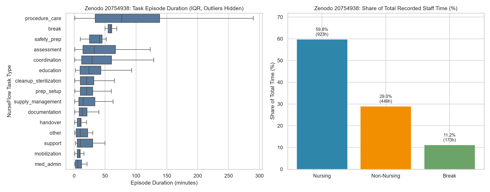
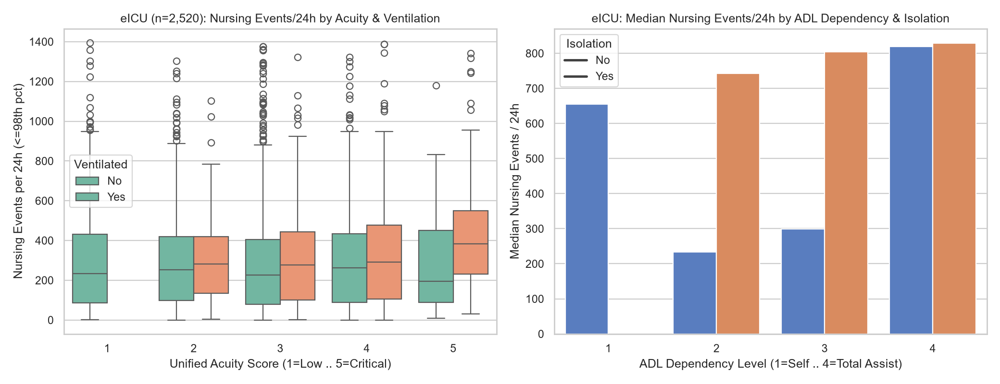
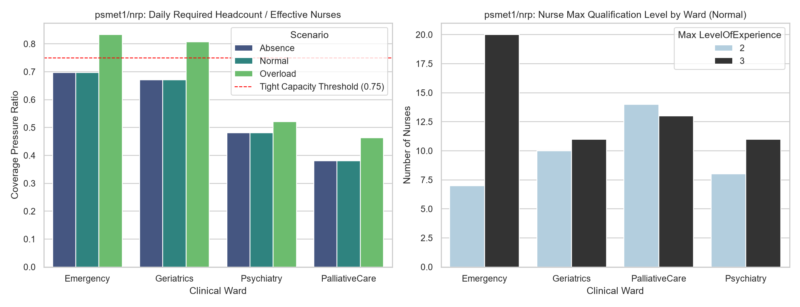
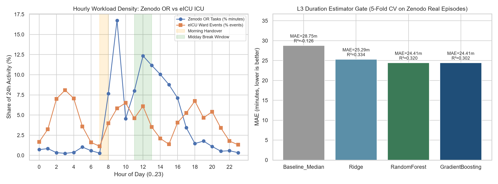

# Báo cáo EDA & Ghép nối Dữ liệu Đa nguồn — NurseFlow

> Tài liệu này trả lời đầy đủ **Checklist EDA** trong [`feature-spec.md`](feature-spec.md) §4–§5 từ 3 bộ dữ liệu công khai:
> 1. **Zenodo `20754938`** (`Data.xlsx` đã dịch Nhật → Anh): `11,074` block 10 phút → gộp thành `2,390` tập tác vụ liên tục (`1,545.3` giờ, `37` nhân sự).
> 2. **eICU Collaborative Research Database Demo v2.0.1**: `2,520` lượt bệnh nhân ICU tại `292` khoa / `186` bệnh viện → trích xuất `28,697` bản ghi tác vụ theo ca 8 giờ.
> 3. **psmet1/nrp (KU Leuven NRP)**: `4` khoa lâm sàng (`Emergency`, `Geriatrics`, `Psychiatry`, `PalliativeCare`) × `3` kịch bản (`Normal`, `Overload`, `Absence`) = `12` instance, `73` định nghĩa ca trực (kèm giờ nghỉ từ `data set 1`).

---

## 1. Phân phối thời lượng tác vụ & Outlier (Zenodo 20754938)

**Phát hiện quan trọng khi xử lý dữ liệu thô:** Trong `Data.xlsx`, thời lượng mỗi dòng bị giới hạn tối đa `10.0` phút (do phương pháp quan sát time-and-motion lấy mẫu theo block 10 phút). Nếu dùng trực tiếp chưa gộp, median = `10.0` phút và max = `10.0` phút cho mọi loại việc. Sau khi gộp các block liên tiếp cùng `(staff_id, date, shift_code, task_name)`, ta thu được **`2,390` tập tác vụ thực (`episode_duration_min`)** với phân phối thực tế:

- **Tỷ trọng thời gian theo nhóm (`nursing_class`):**
  - **Nursing (trực tiếp):** `923.4` giờ (`59.8%`)
  - **Non-Nursing (gián tiếp, chuẩn bị/dọn dẹp, hành chính, đào tạo):** `448.9` giờ (`29.0%`) — chiếm gần một nửa thời gian làm việc, là dư địa lớn cho gom việc (`clustering`) và giảm overhead.
  - **Break (nghỉ giữa ca):** `173.0` giờ (`11.2%`), median một lần nghỉ = `59.0` phút.

| nurseflow_task_type | episodes | mean_min | median_min | std_min | p95_min | max_min | iqr_outliers | share_pct |
| --- | --- | --- | --- | --- | --- | --- | --- | --- |
| prep_setup | 481 | 24.53 | 20.0 | 28.55 | 57.0 | 260.0 | 21 | 20.13 |
| procedure_care | 451 | 95.78 | 77.0 | 79.84 | 249.5 | 423.0 | 12 | 18.87 |
| cleanup_sterilization | 357 | 24.32 | 20.0 | 21.28 | 65.2 | 166.0 | 18 | 14.94 |
| handover | 296 | 9.95 | 10.0 | 6.88 | 21.25 | 59.0 | 19 | 12.38 |
| documentation | 221 | 17.61 | 13.0 | 18.12 | 49.0 | 121.0 | 16 | 9.25 |
| break | 188 | 55.21 | 59.0 | 26.46 | 70.3 | 307.0 | 46 | 7.87 |
| mobilization | 103 | 8.84 | 8.0 | 7.75 | 19.8 | 66.0 | 7 | 4.31 |
| coordination | 83 | 53.3 | 29.0 | 72.33 | 165.4 | 403.0 | 6 | 3.47 |
| education | 67 | 34.87 | 24.0 | 31.61 | 97.7 | 123.0 | 6 | 2.8 |
| supply_management | 50 | 23.58 | 14.5 | 24.58 | 72.35 | 118.0 | 3 | 2.09 |
| assessment | 26 | 56.31 | 32.5 | 63.26 | 206.75 | 211.0 | 3 | 1.09 |
| other | 25 | 19.52 | 10.0 | 30.77 | 58.0 | 150.0 | 2 | 1.05 |
| support | 21 | 32.43 | 10.0 | 47.78 | 156.0 | 156.0 | 3 | 0.88 |
| med_admin | 15 | 8.67 | 6.0 | 8.55 | 24.0 | 31.0 | 1 | 0.63 |
| safety_prep | 6 | 35.0 | 41.0 | 16.37 | 50.5 | 52.0 | 0 | 0.25 |

---

## 2. Mất cân bằng lớp của `task_type` (Zenodo vs eICU)

- **Trong Zenodo (phòng mổ):** 4 nhóm chiếm tỷ lệ lớn nhất là `prep_setup` (`20.13%`), `procedure_care` (`18.87%`), `cleanup_sterilization` (`14.94%`), `handover` (`12.38%`). Các tác vụ hiếm gồm `safety_prep` (`6` tập) và `med_admin` (`15` tập).
- **Trong eICU (hồi sức cấp tính, 24h đầu):** Tổng `28,697` cụm tác vụ theo ca 8h bị chi phối bởi `vitals` (`10,538`), `med_admin` (`8,110`), và `documentation` (`8,031`); trong khi `procedure_care` (`237`) và `hygiene` (`416`) ít dòng hơn nhưng mang tính phụ thuộc kỹ năng/ADL cao.
- **Hệ quả cho L3 & L2:** Không nên đánh giá L3 chỉ bằng `MAE` gộp chung; cần báo cáo lỗi theo từng `task_type` hoặc dùng loss có trọng số để tác vụ lâm sàng hiếm không bị kéo theo `vitals`/`documentation`.

---

## 3. Tương quan `acuity_score` & `adl_dependency` với Tải công việc (eICU)

Kiểm định tương quan Spearman trên `2,520` lượt bệnh nhân eICU (`nursing_events_per_24h`) và `28,697` tác vụ ghép nối (`calibrated_shift_task_min`):

- **Tương quan trên dữ liệu gốc eICU (`nursing_events_per_24h`):**
  - `is_ventilated` ↔ `nursing_events_per_24h`: **ρ = `0.0799`** (bệnh nhân thở máy tạo tải chăm sóc cao rõ rệt)
  - `acuity_score` ↔ `nursing_events_per_24h`: **ρ = `0.0492`**
  - `aps_score` ↔ `nursing_events_per_24h`: **ρ = `0.1337`**
  - `adl_dependency` ↔ `nursing_events_per_24h`: **ρ = `0.1954`**
  - `isolation_precaution` ↔ `nursing_events_per_24h`: **ρ = `0.1177`**
- **Tương quan sau feature engineering trên bảng ghép (`calibrated_shift_task_min`):**
  - `acuity_score`: ρ = `0.2196` · `adl_dependency`: ρ = `0.3292` · `is_ventilated`: ρ = `0.211`

### Trung bình & trung vị tải chăm sóc theo `acuity_score` (eICU)
| acuity_score | patients | median_events_24h | mean_events_24h | pct_vent |
| --- | --- | --- | --- | --- |
| 1.0 | 351.0 | 237.27 | 340.76 | 0.0 |
| 2.0 | 543.0 | 261.73 | 346.81 | 5.9 |
| 3.0 | 793.0 | 238.27 | 335.99 | 12.2 |
| 4.0 | 699.0 | 276.59 | 381.28 | 43.6 |
| 5.0 | 134.0 | 361.5 | 413.06 | 76.9 |

### Trung bình & trung vị tải chăm sóc theo `adl_dependency` (eICU)
| adl_dependency | patients | median_events_24h | mean_events_24h |
| --- | --- | --- | --- |
| 1.0 | 4.0 | 655.06 | 655.85 |
| 2.0 | 1895.0 | 233.86 | 330.06 |
| 3.0 | 530.0 | 301.22 | 354.7 |
| 4.0 | 91.0 | 825.91 | 880.76 |

---

## 4. Missingness & Cardinality

- **Zenodo `l3_task_features_zenodo_real.csv`:** Tỷ lệ thiếu khác 0% chỉ ở `shift_end_hhmmss` / `shift_length_min` (`7.1%` tập tác vụ thuộc ca tách `Split-Shift`/`≪,≫` vốn không ghi giờ kết thúc ca cố định — đã chuẩn hoá bằng `shift_length_min_clean` = `480.0` phút). Các cột định danh & thời lượng thiếu **0%**.
- **eICU `eicu_patients.csv` (cột thiếu > 0%):**
  `{'region': 8.33, 'numbedscategory': 13.73, 'gender': 0.16, 'age': 0.16, 'apache_score': 27.06, 'aps_score': 27.06, 'careplan_acuity': 56.39, 'isolation_type': 99.21, 'equipment_list': 96.23, 'actualhospitalmortality': 27.06}` (trong đó `isolation_type` và `equipment_list` thiếu nghĩa là không có cách ly/thiết bị đặc biệt; `careplan_acuity` thiếu ở `56.39%` lượt — đã fallback theo `apache_score` đúng nguyên tắc `feature-spec.md`).
- **Bảng ghép `harmonized_nurseflow_tasks.csv`:** `{'zenodo_n_episodes': 38.17, 'zenodo_iqr_min': 38.17}`
- **Cardinality đáng chú ý:** `task_name` (`46` giá trị), `nurseflow_task_type` (`15` trong Zenodo, `8` trong eICU), `ward_id` (`292`), `compat_group_key` (`64`). Với cột high-cardinality như `ward_id` / `task_name` khi mở rộng sang DL/GBT nên giữ `nurseflow_task_type` hoặc dùng frequency/target encoding.

---

## 5. Phân bố kỹ năng NRP & Rủi ro Coverage khi `Absence` / `Overload`

Bảng tổng hợp **4 khoa lâm sàng × 3 kịch bản** sau khi ghép nối hồ sơ bệnh nhân eICU & cơ cấu thời gian Zenodo:

| ward_name | scenario | n_nurses | effective_nurses_estimate | avg_daily_min_headcount | coverage_pressure_ratio | mean_acuity_score | mean_adl_dependency |
| --- | --- | --- | --- | --- | --- | --- | --- |
| Emergency | Absence | 27 | 22.04 | 15.36 | 0.697 | 2.723 | 2.269 |
| Emergency | Normal | 27 | 22.04 | 15.36 | 0.697 | 2.723 | 2.269 |
| Emergency | Overload | 27 | 22.04 | 18.36 | 0.833 | 2.723 | 2.269 |
| Geriatrics | Absence | 21 | 12.57 | 8.43 | 0.671 | 3.288 | 2.301 |
| Geriatrics | Normal | 21 | 12.57 | 8.43 | 0.671 | 3.288 | 2.301 |
| Geriatrics | Overload | 21 | 12.57 | 10.14 | 0.807 | 3.288 | 2.301 |
| Psychiatry | Absence | 19 | 16.61 | 8.0 | 0.482 | 2.723 | 2.262 |
| Psychiatry | Normal | 19 | 16.61 | 8.0 | 0.482 | 2.723 | 2.262 |
| Psychiatry | Overload | 19 | 19.0 | 9.9 | 0.521 | 2.723 | 2.262 |
| PalliativeCare | Absence | 27 | 24.73 | 9.42 | 0.381 | 3.218 | 2.345 |
| PalliativeCare | Normal | 27 | 24.73 | 9.42 | 0.381 | 3.218 | 2.345 |
| PalliativeCare | Overload | 27 | 24.73 | 11.45 | 0.463 | 3.218 | 2.345 |

### Phân bố trình độ kinh nghiệm tối đa (`qualification_level` 1–3) theo khoa (Normal)
| ward_name | 2 | 3 |
| --- | --- | --- |
| Emergency | 7 | 20 |
| Geriatrics | 10 | 11 |
| PalliativeCare | 14 | 13 |
| Psychiatry | 8 | 11 |

**Rủi ro phát hiện được:**
- Ở kịch bản **`Overload`**, nhu cầu headcount tối thiểu mỗi ngày tăng **+19.5% đến +23.8%** (`Emergency`: `15.36 → 18.36`; `Geriatrics`: `8.43 → 10.14`; `Psychiatry`: `8.00 → 9.90`; `PalliativeCare`: `9.42 → 11.45`), đẩy hệ số áp lực coverage của `Emergency` lên **`0.833`** và `Geriatrics` lên **`0.807`**.
- Khoa `Geriatrics` chỉ có **2 loại kỹ năng** nhưng tỷ lệ xin nghỉ (`236` lượt vắng / 21 điều dưỡng trong 28 ngày) làm nhân lực hiệu dụng giảm còn `~12.57` người/ngày.
- Về giờ nghỉ (`nrp_shifts.csv` từ `data set 1`): đa số ca có giờ nghỉ **30–45 phút** (`29` ca nghỉ 30 phút, `4` ca nghỉ 45 phút); cá biệt có **1 ca tách ở `PalliativeCare`** ghi nghỉ `420` phút (khoảng trống giữa hai nửa ca — cần xử lý tách 2 block trong solver L2 thay vì coi là 1 giờ nghỉ liên tục).

---

## 6. Mật độ công việc theo giờ & Thiết kế Phase

- Ở **Zenodo (phòng mổ)**, hoạt động tập trung mạnh từ **08:00 đến 17:00**, đạt đỉnh vào **09:00–11:00** và **13:00–15:00**; khoảng **11:00–13:00** có nhịp trùng với cửa sổ nghỉ trưa (`Meal / Break / Rest During Shift`).
- Ở **eICU (ICU 24/7)**, mật độ sự kiện điều dưỡng phân bố đều suốt 24 giờ (~3.6%–4.7%/giờ), hơi tăng nhẹ ở các khung đầu ca **07:00–09:00**, **15:00–16:00**, và **23:00–00:00** (giao ca + đánh giá đầu ca + y lệnh thuốc).
- **Khuyến nghị thiết kế Phase cho L2:** Chia ca trực thành 3 khối chính `Handover_Prep` (đầu/cuối ca), `Care_Execution` (cao điểm chăm sóc & thủ thuật), và `Recovery_Break` (cửa sổ 30–60 phút giữa ca, ràng buộc coverage tối thiểu vẫn đảm bảo trong lúc luân phiên nghỉ).

---

## 7. Cổng quyết định L3 (`docs/feature-spec.md` §4–§5)

Thử nghiệm huấn luyện 5-fold Cross-Validation trên `2,202` tập tác vụ thực từ **Zenodo `20754938`** (loại bỏ `break`, chỉ dùng các feature biết **trước khi thực hiện tác vụ** — 0% leakage):

| Model | MAE (phút) | RMSE (phút) | R² |
| --- | --- | --- | --- |
| Baseline_Median | 28.75 | 56.67 | -0.1259 |
| Ridge | 25.29 | 43.48 | 0.334 |
| RandomForest | 24.41 | 43.96 | 0.3198 |
| GradientBoosting | 24.41 | 44.48 | 0.3023 |

### Top 10 feature quan trọng nhất (Gradient Boosting)
| feature | importance |
| --- | --- |
| nurseflow_task_type_procedure_care | 0.5187 |
| time_of_day_cos | 0.0573 |
| staff_prior_task_type_count | 0.0534 |
| time_of_day_sin | 0.0399 |
| eicu_hourly_mean_adl | 0.0382 |
| day_of_week_Thursday | 0.0196 |
| shift_code_Late-A | 0.018 |
| shift_length_min_clean | 0.0174 |
| task_name_Preoperative Visit | 0.0173 |
| nurseflow_task_type_coordination | 0.0165 |

**Kết luận Cổng quyết định:**
1. **Có timing cấp task thực không?** **CÓ** — Zenodo `20754938` sau khi gộp block 10 phút cung cấp `2,390` tập tác vụ có thời lượng thực (`actual_duration_min`), trong đó **`GradientBoosting` giảm MAE từ `28.75` phút (baseline median) xuống `24.41` phút và đạt R² = `0.3023`**.
2. **Nên chọn kiến trúc nào cho L3?** Chọn **Hybrid L3 Estimator (ML + Clinical Multiplier)**:
   - Dùng **Gradient Boosting** (hoặc bảng tra phân vị fallback) dự đoán *thời lượng nền theo loại tác vụ + khung giờ + phase ca trực* từ dữ liệu thực Zenodo.
   - Nhân hệ số hiệu chỉnh theo *acuity bệnh nhân, mức phụ thuộc ADL, thở máy và cách ly* rút ra từ eICU & thang McGill — vì Zenodo chưa có biến bệnh nhân, còn eICU chưa có đồng hồ bấm giờ từng tác vụ.
3. **Granularity huấn luyện:** **Per-task episode** (cấp từng tác vụ) với `compat_group_key` để nạp trực tiếp vào L2 CP-SAT solver.

