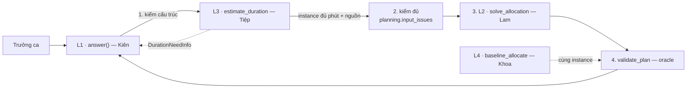
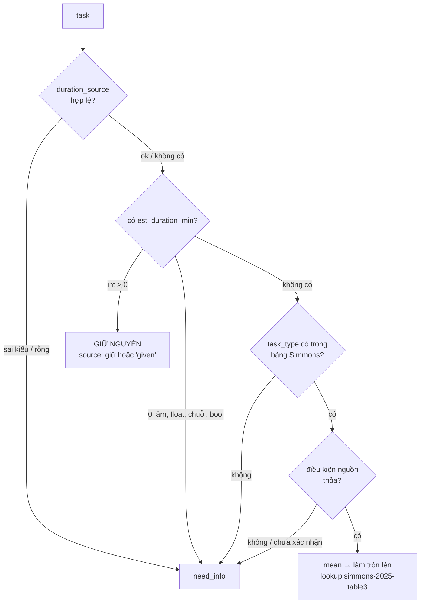
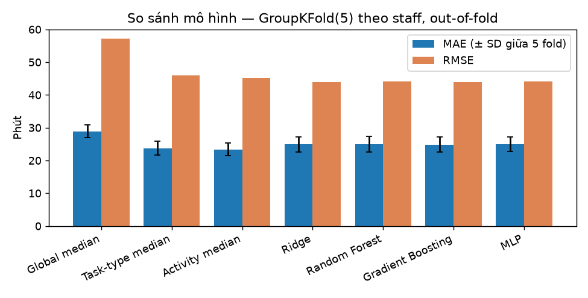
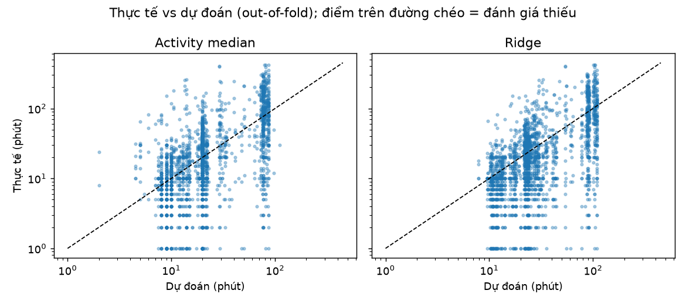
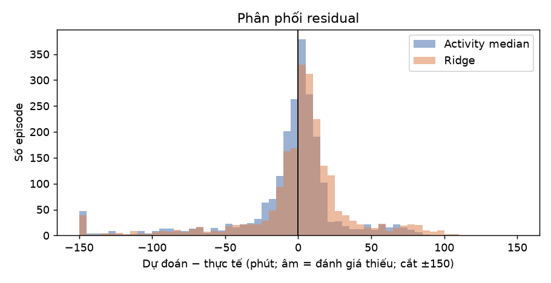
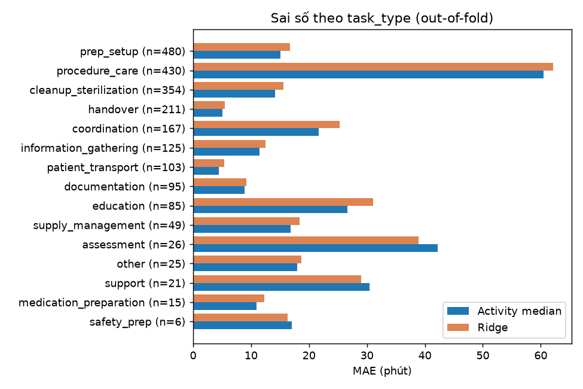
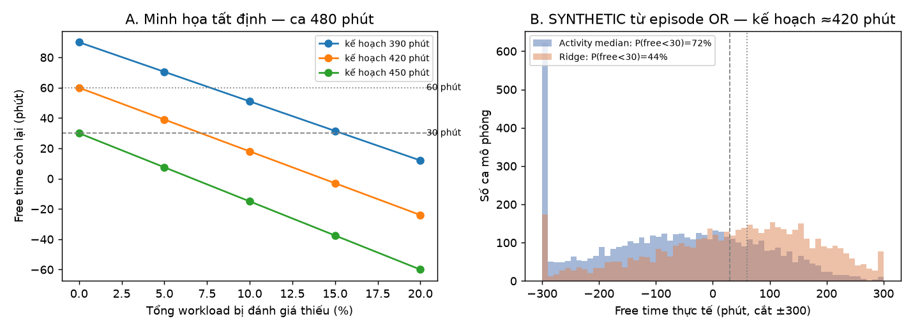

# L3 · Ước lượng thời lượng task (Workload Estimator)

> Chủ module: **Tiệp**. Contract: [`module-contract.md §3.3`](module-contract.md). Cập nhật 28/11/2026 trên `develop` @ `dece854`.
> Tài liệu có hai phần tách biệt: **production nội trú** (đang dùng được) và **thực nghiệm phòng mổ** (chỉ để nghiên cứu, không nạp vào production).

## 1. L3 giải quyết bài toán gì

L2 (CP-SAT engine) cần biết mỗi task mất bao nhiêu phút để kiểm capacity, deadline và giờ nghỉ. Trưởng ca thường không ghi đủ thời lượng cho mọi task.

L3 điền phần còn thiếu theo nguyên tắc **có nguồn thì điền, không có nguồn thì hỏi lại**. L3 không bao giờ tự đặt một con số.

## 2. Vị trí trong NurseFlow



L3 không gọi model ngôn ngữ, không gọi mạng và không ghi file. Đầu vào là một instance; đầu ra là một bản sao của instance đó, khác bản gốc đúng hai trường `est_duration_min` và `duration_source` của task.

## 3. Input / output

**Hàm:** `from workload import estimate_duration` (thêm `codebase/` vào `sys.path`, như `agent.py` đang làm).

| | Mô tả |
|---|---|
| Input | `instance` theo [`cp2-contract`](cp2-contract.md). Task cần `task_id`. Muốn được tra bảng thì task cần thêm `task_type` |
| Output thành công | Bản sao instance. Mọi task có `est_duration_min` (int > 0) và `duration_source` |
| Không đủ căn cứ | raise `DurationNeedInfo`, kèm `.missing_fields` (danh sách chuỗi `tasks.<id>.<field>: lý do`) và `.report` |
| Input hỏng | raise `InvalidInstance`, kèm `.issues` |
| Bảng nguồn lỗi | raise `SourceTableError`. Đây là lỗi kỹ thuật, để harness ghi lại, không chuyển thành `need_info` |

Có thêm `assess_durations(instance) -> dict` cho trường hợp không muốn dùng exception. Hàm trả `{"status": "ok"|"need_info"|"invalid_input", "instance", "estimated", "kept", "missing_fields", "warnings"}`. Schema này là **đề xuất tạm**, cần chốt với Kiên.

## 4. Luồng xử lý một task



Nếu một task bất kỳ rơi vào `need_info`, cả ca trả `need_info` và **không có instance nào được chuyển xuống solver**. Trước khi trả kết quả, L3 còn có một chốt chặn `assert`: mọi task phải có phút hợp lệ và có nguồn.

## 5. Nguồn dữ liệu

| Nguồn | Dùng ở | Ghi chú |
|---|---|---|
| [`ward_task_duration.csv`](../data/reference/ward_task_duration.csv), Simmons et al. 2025, Table 3 ([DOI 10.1111/jgs.19507](https://doi.org/10.1111/jgs.19507)) | Production | 9 loại task, mean phút mỗi lượt bệnh nhân, khoa ACE (Acute Care for Elders, khoa cấp cứu người cao tuổi) tại Mỹ. SHA-256 khớp checksum Lam ghi trong bundle |
| [`instances.json`](../data/preliminary/instances.json), P01–P03 | Contract test | Synthetic kỹ thuật do Lam/Kiên sinh, có `l3_input` và `instance` mong đợi |
| [`l3_activity_features.csv`](../data/processed/l3_activity_features.csv), [Zenodo 20754938](https://zenodo.org/records/20754938) | Thực nghiệm | 2.192 episode, 37 nhân viên phòng mổ (OR — operating room), 08–14/7/2024 |

## 6. Production estimator (nội trú)

**Quy tắc tra bảng:**
- Khớp **chính xác** `task_type`. Không suy từ tên gần giống: `Vitals`, `vital`, `medication_preparation` đều không được tra.
- `mean_duration_min` được làm tròn **lên** bằng `Decimal`, để tránh sai số float (ví dụ 2.54 → 3).
- **Không** hiệu chỉnh theo acuity hay ADL (Activities of Daily Living — mức phụ thuộc sinh hoạt). Nguồn là số tổng hợp, không có chiều này.
- Bảng được đọc từ CSV và kiểm cột, đơn vị, context, số dương, không trùng. Chỉ đọc khi có task cần tra.

**Điều kiện nguồn**, lấy từ cột `staffing_note` và định nghĩa trong bài báo:

| Loại task | Điều kiện để được tra |
|---|---|
| med_admin, wound_care, iv_care, procedure_care, vitals, lab_collection, catheter_care | Tra được, trừ khi task ghi điều kiện ngược lại (bên dưới) |
| toileting | Cần `staff_required == 1` vì nguồn ghi có thể cần hai người |
| mobilization | Cần `staff_required == 1` **và** `mobility_scope` ∈ {`bed_to_chair`, `walking`} |
| Mọi loại | `staff_required` > 1, `setting` khác `inpatient_ward` (ví dụ `operating_room`), `complexity` khác `standard`, hoặc có `synchronization` → `need_info` |

`staff_required`, `mobility_scope`, `setting`, `complexity` là các **trường đề xuất**, chưa có trong contract. L3 chỉ đọc, không bao giờ tự điền. Thiếu các trường này thì cách xử lý an toàn là: toileting/mobilization → hỏi lại, các loại khác → tra theo định nghĩa nguồn. Cách này khớp tinh thần B19 (không lấy giá trị của "chuẩn bị thuốc" cho "cho thuốc") và B20 (mobility phải xác nhận phạm vi và số người).

**Kết quả P01–P03** (so sánh nguyên object với `case["instance"]`):

| Case | Kết quả |
|---|---|
| P01 | 6/6 task giữ 10 phút, nguồn `given`. Khớp |
| P02 | T1 giữ 10 phút `given`. T2 vitals 4 · T3 wound_care 7 · T4 lab_collection 6 · T5 iv_care 4 · T6 catheter_care 3, nguồn Simmons. Khớp |
| P03 | Giống P02. Roster 2 người (đã loại N3) giữ nguyên. Khớp |

## 7. Thực nghiệm ML/DL trên dữ liệu phòng mổ

> **Phạm vi:** target là phút của một *activity episode* tại phòng mổ, không phải thời gian chăm sóc một bệnh nhân nội trú. Model ở đây **không** được dùng làm `est_duration_min` cho NurseFlow.

### 7.1 Kiểm tra dữ liệu

Các con số dưới đây chạy lại từ file, không lấy từ báo cáo EDA:
- 2.192 dòng, 37 nhân viên, không có ô thiếu, không trùng ID, không trùng nội dung, target đều > 0.
- Phân vị target: median 19 phút · P90 98 · P95 156 · P99 260 · max 423. Phân phối lệch phải mạnh.
- 261 episode là outlier theo IQR. **Tôi giữ nguyên tất cả**, không xóa outlier để giảm MAE.

### 7.2 Feature và target

- **Target:** `actual_duration_min`.
- **Feature:** `task_name` (45 mức), `nurseflow_task_type` (15), `task_category` (12), đúng bộ Preliminary.
- **Hạn chế quan trọng:** `task_name` quyết định hoàn toàn hai cột còn lại. Thực chất chỉ có **một** feature dạng phân loại, nên không thể đọc hệ số hay feature importance như ba tín hiệu độc lập.
- **Loại khỏi feature:** `episode_id`, `staff_id` (chỉ dùng chia fold), ngày/giờ bắt đầu/kết thúc (chỉ dùng chia holdout), `source_excel_rows`, target.
- Không tạo thêm acuity, ADL, patient_id hay kinh nghiệm cho dữ liệu này.

### 7.3 Protocol

- **GroupKFold(5) theo `staff_id`**, không xáo dữ liệu, giống script của Lam. Không nhân viên nào nằm ở cả train và test (có `assert` kiểm).
- **Holdout theo thời gian:** train gồm episode kết thúc trước hoặc đúng 13/7/2024, test gồm episode bắt đầu từ 13/7. Train 2.110, test 81, loại 1 episode cắt ngang mốc.
- Mọi encoder và thống kê đều fit trên train của từng fold. Hyperparameter cố định, riêng Ridge chọn alpha ∈ {0.1, 1, 10, 100} bằng GroupKFold lồng bên trong train. Seed 42.
- **Model:**
  - Ba baseline: global median, task-type median, activity median (tra theo tên → nhóm → toàn cục).
  - Ridge (one-hot), Random Forest (300 cây, min_samples_leaf=5), Gradient Boosting (cùng cấu hình GBT của Preliminary).
  - MLP (Multilayer Perceptron — mạng nơ-ron nhiều tầng): 2 tầng ẩn 32/16, target chuẩn hóa, early stopping trên 15% của train. Không có cảnh báo hội tụ; dừng sau 49–135 vòng.
- Dự đoán bị chặn dưới ở 1 phút, là giá trị nhỏ nhất quan sát được.
- **Giới hạn:** chia theo nhân viên vẫn chưa tách theo ca mổ hay bệnh nhân, vì dữ liệu không có các khóa này.

**Tái lập Preliminary:** activity median MAE 23,364 (Lam: 23,3636) và GBT 24,835 (Lam: 24,835). Protocol giống nhau nên so sánh trực tiếp được.

### 7.4 Kết quả (out-of-fold, gộp 2.192 episode)

**Định nghĩa các chỉ số**, với n = số episode đánh giá:
- MAE (Mean Absolute Error) = mean|ŷ−y|.
- RMSE (Root Mean Squared Error) = √mean(ŷ−y)².
- R² (Coefficient of Determination) = 1 − SS_res/SS_tot.
- MedAE = median|ŷ−y|.
- P90/P95 = phân vị 90/95 của |ŷ−y|.
- Tỷ lệ thiếu = #(ŷ<y)/n.
- Thiếu TB = mean(y−ŷ) **trên các ca bị thiếu**.
- Bias = mean(ŷ−y). Bias âm nghĩa là dự đoán thiếu tổng.

| Model | MAE | RMSE | R² | MedAE | P95 | Tỷ lệ thiếu | Thiếu TB | Thiếu max | Bias | MAE fold (TB ± SD) |
|---|---:|---:|---:|---:|---:|---:|---:|---:|---:|---:|
| Global median | 28,91 | 57,18 | −0,12 | 12,0 | 137,5 | 50% | 48,3 | 405 | −19,0 | 28,9 ± 1,9 |
| Task-type median | 23,75 | 45,93 | 0,27 | 10,0 | 93,0 | 47% | 34,4 | 390 | −8,9 | 23,7 ± 2,1 |
| **Activity median** | **23,36** | 45,17 | 0,30 | **10,0** | 90,9 | 47% | 33,1 | 374 | **−7,7** | **23,4 ± 1,9** |
| **Ridge** ✔ | 24,89 | 44,01 | 0,33 | 11,8 | 90,4 | **35%** | 35,2 | 349 | **+0,2** | 24,9 ± 2,4 |
| Random Forest | 24,93 | 44,10 | 0,33 | 11,8 | 91,1 | 38% | 32,5 | 345 | +0,1 | 24,9 ± 2,4 |
| Gradient Boosting | 24,84 | **43,97** | **0,34** | 11,9 | 91,4 | **35%** | 35,3 | 349 | +0,3 | 24,8 ± 2,3 |
| MLP | 24,92 | 44,06 | 0,33 | 11,8 | 90,5 | 38% | 33,0 | 350 | −0,1 | 24,9 ± 2,2 |

**Holdout theo thời gian** (n=81, nhỏ): GBT MAE 25,19 · Ridge 25,26 · activity median 26,85. Cả ba đều thiếu ở 52–69% episode.



### 7.5 Đọc kết quả

- **Không model ML/DL nào thắng activity median về MAE.** Median thắng ở cả 5 fold. Với một feature phân loại duy nhất, mọi model học máy đều hội tụ về *trung bình theo hoạt động*. Đó là ước lượng tối ưu theo bình phương sai số, nên RMSE thấp hơn nhưng MAE cao hơn median. MLP không mang lại gì thêm.
- **Median đánh giá thiếu tổng workload.** Phân phối lệch phải nên median < mean. Bias của median là −7,7 phút/episode, và sai lệch này cộng dồn khi ghép nhiều task vào một ca. Ridge, RF, GBT và MLP có bias xấp xỉ 0.
- **Sai số lớn tập trung ở các hoạt động dài và biến thiên mạnh** (Ridge, n ≥ 20): Scrub Nursing (MAE 67,7, n=189), Shift Leader Duties (61,2), Circulating Nursing (57,8). Thời lượng của các hoạt động này phụ thuộc ca mổ, mà dữ liệu không có thông tin đó.





### 7.6 Model thực nghiệm được chọn: Ridge

| Tiêu chí | Activity median | Ridge |
|---|---|---|
| MAE / MedAE | **tốt hơn** khoảng 1,5 / 1,8 phút | |
| RMSE, R² | | **tốt hơn** (ngang GBT) |
| Ổn định giữa fold | **SD 1,9** | SD 2,4 |
| Đánh giá thiếu (tỷ lệ, bias, tổng ca) | thiếu 47%, bias −7,7 | **thiếu 35%, bias +0,2** |
| Giải thích | bảng tra | hệ số theo từng hoạt động (đọc được) |
| Chi phí inference | tra dict | phép cộng |

L3 cấp **tổng** workload cho L2 để tính free time, nên đánh giá thiếu ở mức tổng là tiêu chí quyết định. Tôi chọn Ridge thay vì GBT vì hiệu năng tương đương nhưng dễ giải thích và rẻ hơn.

Ridge được lưu dạng hệ số JSON ([`or_ridge_v1.json`](../artifacts/l3/or_ridge_v1.json)) kèm metadata, không lưu pickle. Script có kiểm JSON tái tạo đúng dự đoán của sklearn. Metadata ghi `"production": false`.

## 8. Workload, free time và giờ nghỉ

**Các khái niệm cần tách riêng**, theo [`evidence/workload-research.md`](../evidence/workload-research.md):

| Khái niệm | Nghĩa trong NurseFlow |
|---|---|
| Workload theo thời lượng | Tổng phút task + chuyển phòng. L3 cấp phần phút task |
| Workload theo mức nặng | Cường độ chăm sóc (acuity, tỷ lệ bệnh nhân/RN). Hai ca cùng 420 phút có thể nặng khác nhau. L3 hiện **không** đo phần này |
| Planned / Unplanned workload | Việc biết từ đầu ca / việc phát sinh trong ca. L3 chỉ ước lượng phần planned |
| Free time | Ca − workload. Đây là **quỹ thời gian**, chưa phải nghỉ thực tế |
| Protected break | Block nghỉ được lịch bảo vệ (có người trực thay) |
| Actual / Interrupted break | Nghỉ thực sự diễn ra / nghỉ bị cắt ngang. Cần event log, hiện chưa có |
| Buffer | Phần free time giữ lại cho việc phát sinh |

**Mốc nghiên cứu cho ca 480 phút:** workload 450 phút còn 30 phút nghỉ; 420 phút cho Hybrid 60 phút; 390 phút nếu giữ thêm buffer 30 phút. Đây **không phải** ngưỡng quá tải lâm sàng phổ quát. L3 không sửa `break_policy` hay ràng buộc cứng của L2 theo các mốc này.

**Độ nhạy khi dự đoán thiếu** ([`workload_sensitivity.json`](../artifacts/l3/workload_sensitivity.json)):
- **A. Phép tính tất định, không dùng dữ liệu.** Kế hoạch 420 phút mà workload thật cao hơn 10% thì chỉ còn 18 phút, dưới mốc 30. Kế hoạch 450 phút nằm đúng trên mốc 30 phút, nên chỉ cần thiếu vài phút là đã vi phạm (thiếu 5% thì còn 7,5 phút). Kế hoạch 390 phút chịu được thiếu khoảng 15%.
- **B. Mô phỏng SYNTHETIC.** Mỗi ca được ghép bằng cách lấy ngẫu nhiên (có hoàn lại, seed 42, 5.000 ca/mức) các episode phòng mổ với dự đoán out-of-fold thật, tới khi tổng dự đoán đạt mức kế hoạch. Đây **không phải** quan sát ca nội trú. Episode phòng mổ dài và biến thiên hơn task nội trú nhiều. Tổng dự đoán thực tế vượt mức khoảng 25–30 phút, vì một episode có thể rất dài.

| Mức kế hoạch | P(free < 30), activity median | P(free < 30), Ridge | P(free < 30), GBT |
|---|---:|---:|---:|
| ≈390 | 64% | 37% | 38% |
| ≈420 | 72% | 44% | 45% |
| ≈450 | 79% | 53% | 51% |



**Ý nghĩa cho thiết kế:**
1. Chọn estimator theo MAE từng task có thể làm L2 tính dư free time một cách hệ thống. Cần theo dõi bias và đánh giá thiếu ở mức tổng ca.
2. Ngay cả khi không lệch, phương sai lớn vẫn khiến mốc 30 phút dễ bị vi phạm. Nên dùng buffer, hoặc dự đoán theo phân vị cao (ví dụ P75), cho các task biến thiên mạnh.

## 9. Kết quả kiểm thử

Các mức kiểm thử được tách riêng, không gộp làm một:

| Mức | Nội dung | Kết quả |
|---|---|---|
| Unit L3 | `tests/test_workload.py`: given, giá trị sai, source, Simmons, điều kiện nguồn, CSV lỗi, bảo toàn input, timestamp, không bịa, ranh giới production | **45/45 OK** (gồm contract test) |
| Contract L3 | P01–P03 so với `case["instance"]`, kèm checksum CSV | **4/4 OK** (nằm trong 45 test trên) |
| Integration L3 | `tests/test_workload_integration.py`: L3 → `input_issues` → `solve_allocation` (**heuristic CP2, chưa phải CP-SAT**) → `validate_plan`; `need_info` dừng trước solver | **2/2 OK**. Test L4 skip vì `baseline.py` chưa merge. Chạy thử với bản đọc từ `feat/khoa-l4-baseline` thì pass |
| End-to-end NurseFlow | `answer()` → L3 → L2 → validator | **Chưa đạt**. `answer()` chưa gọi L3. Với P02, `answer()` hiện trả `need_info` vì `input_issues` chặn trước |
| Toàn repo | `python -m unittest discover -s tests` | 86 test: OK khi bật `PYTHONUTF8=1`. Với encoding mặc định của Windows, 2 test của `test_data_pipeline.py` lỗi `UnicodeDecodeError`. Lỗi này không liên quan L3 |

## 10. Hướng dẫn tích hợp (Kiên, Lam)

**Thứ tự gọi đề xuất trong `agent.answer()`** (Kiên thực hiện; L3 không sửa `agent.py`):

```python
from workload import estimate_duration, DurationNeedInfo, InvalidInstance  # SourceTableError: để nổi lên

try:
    instance = estimate_duration(instance)            # 1–2. L3 tự kiểm phần cấu trúc nó cần
except InvalidInstance as e:
    return need_info(e.issues)
except DurationNeedInfo as e:
    return need_info(e.missing_fields)                # câu hỏi lại cho trưởng ca
issues = input_issues(instance)                       # 3. kiểm đủ (giờ đã có duration)
if issues:
    return need_info(issues)
plan = solve_allocation(instance)                     # 4. L2
validation = validate_plan(instance, plan)            # 5. oracle
```

**Lý do phải đổi thứ tự:** `planning.input_issues` coi thiếu `est_duration_min` là lỗi. Nếu gọi nó trước L3, task thiếu phút sẽ bị chặn và L3 không bao giờ chạy (đã kiểm với P02). Có hai cách sửa, đều thuộc phần Kiên hoặc Lam:
- **(a)** gọi L3 trước như đoạn code trên;
- **(b)** tách phần kiểm duration khỏi `input_issues`.

Nên bọc `estimate_duration` bằng `@tool` trong `tools.py` để trace ghi lại.

**Ví dụ:**
- **Given:** task `{"task_type": "med_admin", "est_duration_min": 10}` → giữ 10, `duration_source: "given"`.
- **Lookup:** task `{"task_type": "vitals"}` → `est_duration_min: 4`, `duration_source: "lookup:simmons-2025-table3"`.
- **need_info:** task `{"task_type": "toileting"}` → `DurationNeedInfo`, `missing_fields = ["tasks.T2.staff_required: Incontinence Care/Toileting Assistance có thể cần hai nhân viên (Simmons Table 3); cần xác nhận số người hỗ trợ trước khi tra"]`.

**Cho Lam (L2):** mọi instance L3 trả về đều có `est_duration_min` là int > 0, nên `assignment.end − start == est_duration_min` dùng được ngay. `duration_source` chỉ là metadata, solver không cần đọc.

## 11. Giới hạn

- Bảng Simmons là mean tổng hợp ở khoa ACE Mỹ, không có biến thiên theo bệnh nhân. Phút thật của một bệnh nhân cụ thể có thể khác nhiều (SD xấp xỉ mean).
- Các trường điều kiện (`staff_required`, …) chưa được chốt trong contract, nên L1 chưa thu thập chúng.
- Model phòng mổ chỉ có một feature, R² khoảng 0,33. Không chuyển được sang nội trú.
- Mô phỏng free time là synthetic, giả định episode độc lập, chưa có việc phát sinh và chuyển phòng.

## 12. Hướng phát triển (chỉ là đề xuất, chưa làm)

- **Event log** bắt đầu/kết thúc task do điều dưỡng xác nhận. Đây là nguồn nhãn duration nội trú đúng nghĩa, khác với `charttime`/`storetime`.
- **Feedback loop:** so phút kế hoạch với phút thực tế, rồi hiệu chỉnh bảng hoặc model theo khoa.
- **Dự đoán task phát sinh** và buffer theo khung giờ. Tách planned và unplanned workload.
- **Theo dõi nghỉ thực tế** (được nghỉ hay bị gián đoạn) để đánh giá protected break.
- **Dự đoán theo phân vị** (quantile) thay cho trung bình, dành cho task biến thiên mạnh.

## 13. Tái lập

```bash
python -m pip install -r requirements.txt                 # pandas, numpy, scikit-learn, matplotlib (đã có trong repo)
python -m unittest tests.test_workload tests.test_workload_integration
python scripts/l3/train_or_experiment.py                  # ~10 giây CPU → artifacts/l3/or_*.csv|json
python scripts/l3/build_artifacts.py                      # model JSON + metadata + độ nhạy + docs/figures/l3_*.png
```
