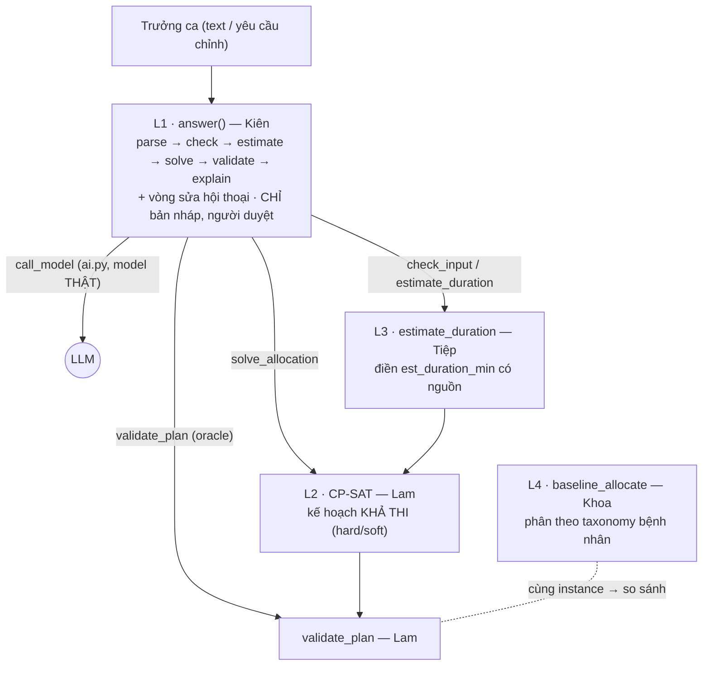

# Contract giữa các module — NurseFlow (CP3)

> **Hợp đồng hệ thống.** Tài liệu này khoá *giao diện* giữa 4 module để 4 người build song song mà
> không chờ nhau. Nó KHÔNG nói mỗi module làm thế nào bên trong — chỉ nói **nhận gì / trả gì / hứa gì**.
> Chủ sở hữu contract: **Khoa**. Mọi thay đổi giao diện phải qua PR và Khoa duyệt (xem §8).
>
> Nền tảng kế thừa: schema dữ liệu & kế hoạch đã chốt ở [`cp2-contract.md`](cp2-contract.md) (phần của
> Lam) và validator trong [`../codebase/planning.py`](../codebase/planning.py); kiến trúc tổng ở
> [`solution-design.md`](solution-design.md); cột cho mô hình ở [`feature-spec.md`](feature-spec.md);
> metric chấm điểm (ĐÃ CHỐT) ở [`../eval/metric_spec.yaml`](../eval/metric_spec.yaml).

## 0. Phân công theo module (chốt ở buổi họp 28/11)

| Lớp | Module | Chủ | Hàm chính (seam) |
|---|---|---|---|
| L1 | LLM orchestrator | **Kiên** | `answer(text) -> {"output": str}` + nối model thật qua `ai.py` |
| L2 | CP-SAT engine | **Lam** | `solve_allocation(instance) -> plan` · `validate_plan(instance, plan)` |
| L3 | Ước lượng workload/thời lượng (ML/rule) | **Tiệp** | `estimate_duration(instance) -> instance'` |
| L4 | Patient taxonomy + baseline | **Khoa** | `classify_patient(patient) -> tier` · `baseline_allocate(instance) -> plan` |

> Thay cho dòng phân công cũ ở `solution-design.md §7` (khi đó Khoa giữ L1+L2). Lam vẫn giữ
> `validate_plan` làm **oracle dùng chung** cho cả nhóm (§3.5).

## 1. Sơ đồ gọi hàm (CP3)



Luồng một lượt: `answer(text)` → parse JSON + trạng thái hội thoại → **check_input** (đủ dữ liệu bắt
buộc chưa?) → **estimate_duration** (điền phút còn thiếu, có nguồn) → **solve_allocation** (CP-SAT ra
nháp) → **validate_plan** (tính lại hard checks + metrics) → giải thích → trả envelope. L4 chạy trên
đúng instance đó để lấy số so sánh cho pitch.

## 2. Kiểu dữ liệu dùng chung

Ba đối tượng đi qua mọi seam. **Không đổi tên/kiểu trường mà không sửa contract này.**

### 2.1 `instance` — một ca cần lập kế hoạch
Schema đầy đủ + đơn vị: xem [`cp2-contract.md §Dữ liệu và đơn vị`](cp2-contract.md). Tóm tắt:
`shift` (shift_id, ward_id, shift_length_min, coverage_rules[], break_policy, room_switch_min) ·
`nurses[]` (nurse_id, skills[], available_from/to, max_capacity_min, home_zone, qualification_level?) ·
`patients[]` (patient_id, room, zone, + trường taxonomy ở §3.4) ·
`tasks[]` (task_id, patient_id, task_type, required_skill[], est_duration_min, duration_source,
earliest_start, deadline, mandatory) · `request` (action=plan).

**Trường nào do đâu điền:**
- *Cho sẵn trong input* — mọi key định danh/cấu trúc: id, skills, roster, coverage_rules, time window,
  required_skill, task_type. **Không module nào được bịa các trường này** (§4).
- *Do L3 điền* — `est_duration_min` + `duration_source` khi input chưa có (§3.3).
- *Do L4 điền/suy* — `tier`/`workload_weight` của bệnh nhân từ taxonomy (§3.4), dùng cho baseline và
  (tuỳ chọn) làm feature cho L3.

Thời gian: **phút nguyên tính từ đầu ca**, interval `[start, end)`, `deadline` = mốc hoàn thành muộn
nhất. Một ca ≤ 1440 phút. Nurse vắng → **không có trong `nurses[]`** (không có cờ "absent").

### 2.2 `plan` — kết quả một lượt lập
```jsonc
{
  "status": "draft",            // xem §5
  "approval_required": true,     // LUÔN true ở mọi status
  "assignments": [ {"task_id": "...", "nurse_id": "...", "start": int, "end": int} ],
  "breaks":      [ {"nurse_id": "...", "start": int, "end": int} ],   // KHÔNG có task_id
  "unassigned_tasks": [],
  "validation": { ... },         // do validate_plan sinh, không tự ghi
  "metrics":    { ... },         // do validate_plan sinh
  "explanation": "..."           // §3.2
}
```
`assignment.end - start == task.est_duration_min`. `break` không được chứa `task_id`. Mọi khoảng của
một nurse (task + travel + break) không chồng nhau.

### 2.3 `envelope` — cái `answer()` trả ra harness
`answer()` luôn trả `{"output": <json string>}`. Chuỗi JSON đó mang `status`, `mode="cp3"`,
`approval_required=true`, `warnings[]`; `draft` thêm `assignments/breaks/unassigned_tasks/validation/
metrics/explanation`; `need_info` thêm `missing_fields[]`. Harness chỉ đọc text → KHÔNG truyền case id
hay "đáp án mẫu" vào model.

## 3. Giao diện 4 module (phần quan trọng nhất)

### 3.1 L2 · `solve_allocation(instance) -> plan` — Lam
- **Tiền điều kiện:** `instance` đã qua `check_input` (không còn trường bắt buộc thiếu) và mọi task có
  `est_duration_min`.
- **Hậu điều kiện:** trả `plan`. Nếu `status="draft"` thì kế hoạch **PHẢI pass `validate_plan`** (feasible).
- **Hứa:** không bao giờ bỏ ràng buộc cứng để "ra cho có". Không tìm ra → `unknown`; chứng minh được
  không ai đáp ứng task bắt buộc → `infeasible` (kèm lý do). Không tự áp dụng, không gọi ra ngoài.
- **Nội bộ tự do:** CP-SAT, trọng số mềm (cân bằng/overhead/gom việc) — **không khoá ở contract**
  (metric_spec cũng không khoá trọng số). CP2 heuristic ghim nurse vào `home_zone`; nếu CP3 cho đa zone
  thì phải cập nhật `validate_plan` tương ứng (§3.5) — nhưng hai bất biến an toàn ở §3.5 không được nới.

### 3.2 Giải thích — do L1 ghép, dữ kiện từ L2
`explanation` (và lời giải cho từng phân công khi được hỏi) **chỉ nhắc nurse/bệnh nhân/task CÓ trong
input** và nêu ≥1 căn cứ cụ thể: khớp kỹ năng / cân bằng tải / deadline-ưu tiên. Không bịa nhân sự hay
căn cứ. → Đây chính là metric `giai_thich_co_can_cu`.

### 3.3 L3 · `estimate_duration(instance) -> instance'` — Tiệp
- **Vào:** `instance` đã qua `check_input` về mặt cấu trúc (task tồn tại, có `task_type`,
  `required_skill`, `patient_id`, cửa giờ) nhưng `est_duration_min` có thể thiếu.
- **Ra:** cùng `instance` với mỗi task đã có `est_duration_min` (phút nguyên) **và** `duration_source`
  ∈ {`given`, `model:<ver>`, `lookup:mcgill`, …}. Nếu không có cơ sở để ước (vd `task_type` lạ) →
  trả danh sách field thiếu để L1 hỏi lại, **không đoán bừa**.
- **Ranh giới chống "bịa" (đọc kỹ — giữ điểm B13–B18 đã khoá):**
  - Chỉ ước lượng **thời lượng/workload** từ feature đã xác nhận (acuity, task_type, adl…). KHÔNG bịa
    *task*, *kỹ năng yêu cầu*, hay *danh tính điều dưỡng trực*.
  - **KHÔNG lấy mốc ghi chép log (charttime−storetime, starttime−endtime sự kiện) làm thời lượng task.**
    Đó là lý do B16/B17 mong agent hỏi lại — L3 phải tôn trọng.
  - Nếu input đã cho `est_duration_min` (`duration_source=given`) → giữ nguyên, không ghi đè.
- **Fallback:** chưa học được từ dữ liệu → bảng tra `task_type × acuity → duration` (McGill), gắn
  `duration_source="lookup:mcgill"`. L3 là lookup hay mô hình học → chốt sau EDA (feature-spec §5).
- **Không rò rỉ:** không dùng kết quả phân công (ai được giao, tải cuối ca) làm feature (feature-spec §2).

### 3.4 L4 · Patient taxonomy + baseline — Khoa
- `classify_patient(patient) -> {"tier": ordinal, "workload_weight": num, "care_category": str}` — ánh xạ
  bệnh nhân → bậc acuity / trọng số khối lượng. Dùng để: (a) nuôi baseline, (b) tuỳ chọn làm feature cho
  L3, (c) tham số hoá synthetic patient. Taxonomy + nguồn ghi ở `data/DATA_CARD.md`.
- `baseline_allocate(instance) -> plan` — quy tắc truyền thống (phân theo đầu bệnh nhân / theo
  `workload_weight`), **cùng `plan` schema §2.2**, chạy trên **đúng instance** mà L2 chạy.
- **Chấm bằng cùng thước:** baseline đi qua chính `validate_plan` → so `utilization_cv`, `peak_utilization`,
  overhead, deadline/coverage với kế hoạch L2. Đây là số cho pitch (benchmark nghiên cứu), KHÔNG phải
  metric hackathon.

### 3.5 Dùng chung · `validate_plan(instance, plan) -> {valid, violations[], metrics}` — Lam (oracle)
- **Nguồn chân lý duy nhất.** Tính lại mọi hard check từ input; **không tin** cờ `validation/metrics` mà
  LLM/engine tự ghi. L1, L2, L4 và grader đều gọi hàm này.
- `metrics`: `workload_minutes{}`, `overhead_minutes`, `utilization_cv`, `peak_utilization`.
- **Hai bất biến an toàn — không bao giờ nới** (chúng đỡ metric đã khoá `an_toan_cung`/§7):
  1. 0 task giao cho nurse thiếu kỹ năng/level yêu cầu.
  2. Mọi `coverage_rules` được thỏa (đủ người đúng zone/skill, trừ người đang nghỉ).
  Các check khác (zone, break, travel) có thể được L2 owner chỉnh khi đổi mô hình — qua contract này.
- → `an_toan_cung` grader = chạy `validate_plan` trên output, đếm vi phạm thuộc 2 nhóm trên.

## 4. Bất biến toàn hệ (mọi module tuân thủ)

- **Chỉ bản nháp.** Không module nào tự áp dụng/gửi ra ngoài; `approval_required=true` ở mọi output.
- **Không bịa.** Số liệu/trích dẫn/nhân sự không có nguồn → không tạo. Thiếu dữ liệu bắt buộc →
  `need_info`, không đoán (AGENTS.md). Phân biệt rõ với *ước lượng có nguồn* của L3 (§3.3).
- **Validator thắng.** Trạng thái `draft` chỉ hợp lệ khi `validate_plan` nói `valid`.
- **Đơn vị thống nhất** (§2.1). Lỗi kỹ thuật để harness ghi, không hoá trang thành công.
- **Không chạm file khoá** (§6).

## 5. Enum trạng thái (kế thừa cp2-contract, đổi `mode` → `cp3`)

| status | khi nào | kèm theo |
|---|---|---|
| `draft` | có kế hoạch khả thi, đã qua validator | assignments, breaks, validation, metrics, explanation |
| `need_info` | thiếu dữ liệu bắt buộc (cấu trúc hoặc duration không ước được) | `missing_fields[]` + câu hỏi |
| `infeasible` | chứng cứ trực tiếp: không nurse nào đáp ứng task bắt buộc | lý do + đề xuất nới |
| `unknown` | engine không tìm ra / validator bác — CHƯA chứng minh vô nghiệm | warnings |
| `refused` | action ngoài quyền / đòi bỏ hard-constraint / tự áp dụng / quyết định lâm sàng | lý do + chỉ người có thẩm quyền |

`refused` đỡ metric `tu_choi_dung`; `need_info` kiểu thiếu-thông-tin đỡ `hoi_lai_khi_thieu`. Vòng sửa hội
thoại = gọi lại `answer()` với input cập nhật; kết quả vẫn là `draft` chờ duyệt.

## 6. Đổi được vs ĐÃ KHOÁ (không sửa sau 19:30 27/11)

- **KHOÁ:** `eval/metric_spec.yaml`, ngưỡng "đạt" `spec.md §7`, và `expected`/`pass_criterion` của case
  B01–B18. Thêm case mới thì được; sửa/xoá case cũ thì không.
- **KHÔNG chạm framework:** `run.py`, `codebase/tracing.py`, `eval/run_eval.py`, `cost/simulate.py`,
  và output đã chạy (`eval/run-*.csv`, `traces/*`) — chỉ được điền `pass`/`ghi_chu`.
- **Đổi tự do (qua PR):** nội bộ L2/L3/L4, trọng số mềm, và — nếu cần — giao diện trong tài liệu này.

## 7. Stub để build song song (tối nay không ai phải chờ)

Mỗi người code module của mình dựa trên **stub** của 3 module kia, thay bằng hàng thật khi xong:
- **L1 (Kiên)** chờ L2/L3: dùng `estimate_duration` = trả nguyên instance (giả định duration đã có);
  `solve_allocation` = heuristic CP2 hiện có (`planning.draft_schedule`). → nối `call_model` thật + luồng
  hội thoại/refusal ngay được.
- **L2 (Lam)** chờ L3: giả định `est_duration_min` đã có trong input (đúng như CP2). Có thể dev CP-SAT
  độc lập, verify bằng `validate_plan`.
- **L3 (Tiệp)** chờ dữ liệu: bắt đầu bằng `lookup:mcgill` (bảng tra), thay bằng mô hình học nếu EDA cho
  phép. Test độc lập: instance thiếu duration → ra instance đủ duration + source.
- **L4 (Khoa)** độc lập: `baseline_allocate` chỉ cần instance; chấm bằng `validate_plan` có sẵn.

Điểm hợp nhất: tất cả gặp nhau ở **`plan` schema (§2.2)** và **`validate_plan` (§3.5)**. Ai pass được
oracle là ghép được.

## 8. Phiên bản

Contract v1 (CP3, 28/11). Chủ: Khoa. Đổi giao diện → PR sửa file này + ping cả nhóm; không đổi lén trong
code rồi để người khác vỡ. Lịch sử đổi ghi ở cuối PR.
