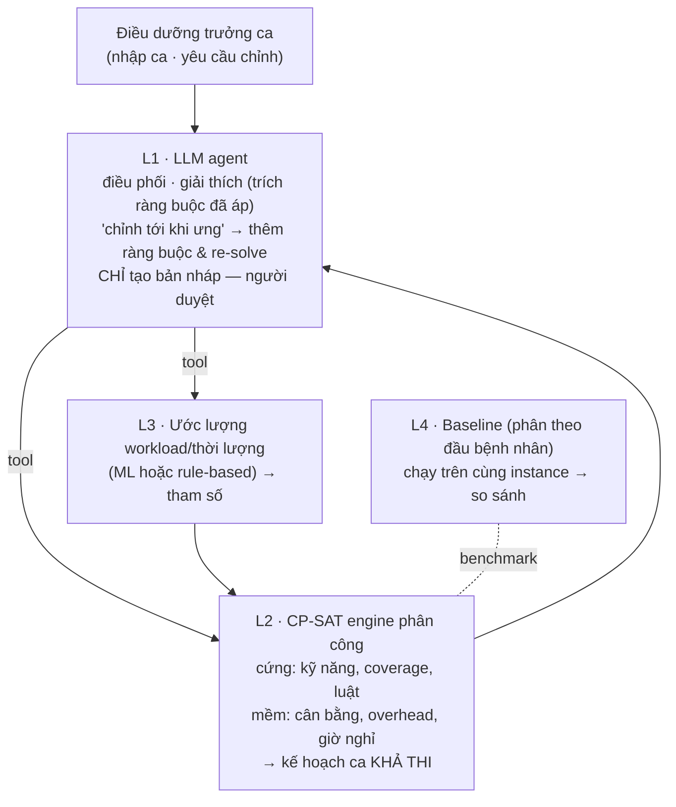

# NurseFlow — Thiết kế giải pháp & Yêu cầu dữ liệu

> Tài liệu làm việc chung của nhóm. Chốt kiến trúc **trước khi** nhóm dữ liệu khoá dataset, để việc
> tìm/kiểm/EDA nhắm đúng trường cần, và để Tiệp định nghĩa đúng baseline. Nguồn bài toán:
> [`Problem-Gap-Solution.md`](../Problem-Gap-Solution.md) · lát cắt: [`spec.md`](../spec.md) §4.

## 1. Nhìn nhận cốt lõi: bài toán có HAI lớp

- **Engine phân công** = bài toán **tối ưu tổ hợp / thoả ràng buộc** (gán việc cho điều dưỡng theo kỹ
  năng, acuity, thời lượng, deadline, coverage) — NP-hard, địa hạt của **CP-SAT / MILP / metaheuristic**,
  KHÔNG phải việc của một mạng nơ-ron thô.
- **Sản phẩm AI mà hackathon chấm** = một **LLM agent**. Trong khung repo, `codebase/ai.py` →
  `call_model` là lời gọi AI trung tâm (bắt buộc model thật từ CP3); eval đưa text → `answer()` → text.
  **Engine là một công cụ (`@tool`) mà LLM gọi**, không phải bản thân lời gọi AI trung tâm.

→ Vì vậy "giải tất cả bằng một DL model" là **không** nên: (a) ràng buộc an toàn cứng không sống sót qua
đầu ra xác suất của mạng nơ-ron nếu không ép bằng cấu trúc, (b) trọng tâm khung là LLM agent + công cụ.

## 2. Quyết định đã chốt

- **Engine lõi = hybrid lấy tối ưu làm lõi:** CP-SAT làm engine phân công; ML/rule-based ước lượng
  tham số nạp vào; LLM làm orchestrator + giải thích + sửa theo hội thoại.
- **Phạm vi = full richness:** khớp kỹ năng + gom việc + chia phase (có giờ nghỉ được bảo vệ) +
  re-solve động (do người kích hoạt) đều là **must-have**.

## 3. Kiến trúc (hybrid phân lớp)

- **L1 LLM (Khoa):** workflow cố định — *estimate → solve → explain* — kèm vòng sửa hội thoại nhẹ
  (thêm/nới một ràng buộc mềm → re-solve → hiện diff). Công cụ dự kiến trong `codebase/tools.py`:
  `estimate_workload`, `solve_allocation` (CP-SAT), `validate_plan`, `export_plan_draft`
  (có tác động ra ngoài → chỉ bản nháp chờ duyệt, theo [`AGENTS.md`](../AGENTS.md)).
- **L2 CP-SAT (Khoa + người giữ solver):** đảm bảo kế hoạch khả thi; mô hình hoá gom việc
  (vị trí/thiết bị/loại chăm sóc), chia phase + giờ nghỉ, và cân bằng tải thành ràng buộc/mục tiêu.
- **L3 ước lượng (nhóm dữ liệu cho biết khả thi):** DL chỉ xứng đáng ở đây, và chỉ khi EDA cho thấy tín
  hiệu thời lượng/workload học được; nếu không, dùng rule-based theo McGill tool. (Tabular thường
  gradient-boosting ≥ DL — giữ đầu óc mở.)
- **L4 baseline (Tiệp):** quy tắc phân theo đầu bệnh nhân, chạy trên đúng các instance.

> **Lưu ý khớp lát cắt:** "re-solve động" ở MVP = **người kích hoạt** re-solve với đầu vào cập nhật
> (điều dưỡng báo vắng, có ca nhập mới) — KHÔNG phải tự giám sát liên tục. Khớp với `spec.md` §4.

## 4. Tính năng — must-have vs nice-to-have (MVP full richness)

**Must-have (CP3/CP4):**
- Gán việc theo kỹ năng/năng lực (khớp kỹ năng — ràng buộc cứng)
- Ràng buộc coverage theo khu vực/khung giờ (cứng — an toàn người bệnh)
- Cân bằng tải (mềm: giảm imbalance CV + peak load)
- Gom việc tương thích (vị trí/khoảng cách, thiết bị/chuẩn bị, loại chăm sóc)
- Chia phase + giờ nghỉ được bảo vệ (ràng buộc coverage khi nghỉ)
- Re-solve do người kích hoạt với đầu vào cập nhật (phân công lại động theo yêu cầu)
- Ước lượng workload/thời lượng nạp vào solver (ML hoặc rule-based)
- LLM: giải thích kế hoạch + sửa theo hội thoại → đổi ràng buộc → re-solve
- Mọi thứ là bản nháp chờ duyệt (không tự áp dụng)

**Nice-to-have (stretch):**
- Dùng DL estimator thay rule-based (tuỳ kết quả EDA)
- Neural combinatorial optimizer end-to-end làm engine thay thế (hướng nghiên cứu)
- Tự phát hiện sự kiện / giám sát liên tục
- Heatmap workload đẹp, nhiều khoa

**Ngoài phạm vi (nói không dứt khoát):** quyết định lâm sàng (chẩn đoán, thuốc, tiên lượng); tự áp dụng
không cần duyệt; tích hợp HIS thật; mọi tuyên bố cải thiện kết cục lâm sàng.

## 5. Yêu cầu dữ liệu (sản phẩm giao cho Lam, Kiên, Tiệp)

Thực thể & trường mà engine tiêu thụ (★ = trường must-have, ◇ = trường full-richness):

| Thực thể | Trường | Nguồn khả dĩ |
|---|---|---|
| Nurse (điều dưỡng) | ★id, ★kỹ năng/chứng chỉ, ★sẵn sàng trong ca (vắng = để trống), ★capacity, ★mức kinh nghiệm, ◇khu vực phụ trách | Rostering benchmarks (KU Leuven/schedulingbenchmarks), MatchRN |
| Patient (bệnh nhân) | ★id, ★điểm acuity, ★nhu cầu chăm sóc, ◇phòng/khu vực | McGill workload tool (acuity→workload), MatchRN |
| Task (công việc) | ★id, ★loại, ★kỹ năng yêu cầu, ★ước lượng thời lượng, ★khung giờ/deadline/ưu tiên, ★bệnh nhân gắn với, ◇thiết bị/chuẩn bị, ◇tương thích/thứ tự | **Không dataset nào có — sinh synthetic, tham chiếu thời lượng McGill** |
| Ward/shift (khoa/ca) | ★luật coverage (tối thiểu điều dưỡng/kỹ năng theo khu·giờ), ◇cấu trúc phase, ◇chính sách nghỉ + coverage lúc nghỉ | Rostering benchmarks, CMS PBJ (bối cảnh) |
| Dữ liệu huấn luyện estimator | (loại task, acuity, bối cảnh) → thời lượng/điểm workload thực tế | McGill methodology, MatchRN perceived workload |
| Baseline (Tiệp) | quy tắc phân theo đầu bệnh nhân + metric trên cùng instance | suy ra, không phải đi tìm |

> **Cột/feature cụ thể cho mô hình** (để EDA + feature engineering): xem [`feature-spec.md`](feature-spec.md).

**Thông điệp chính cho nhóm dữ liệu:** không dataset đơn lẻ nào có task cấp điều dưỡng kèm đủ
thời lượng + deadline + vị trí + thiết bị. Nên **việc EDA** là: (a) đặc tả phân phối thực của
acuity→workload, thời lượng task, luật coverage, mức staffing từ McGill + benchmarks + MatchRN; và
(b) xác nhận **mỗi dataset thực sự cung cấp trường nào**. Sau đó bộ sinh synthetic được tham số hoá theo
các phân phối thực đó để lấp phần thiếu (gắn nhãn `synthetic`, ghi seed/cách sinh trong
[`data/DATA_CARD.md`](../data/DATA_CARD.md); **data synthetic KHÔNG phải bằng chứng pain**).

## 6. Khớp với khung hackathon (chuẩn bị cho CP2, chưa làm bây giờ)

- `spec.md` §4 hình dạng = LLM orchestrator (workflow cố định + vòng sửa nhẹ), công cụ như mục 3.
- **Hai nhánh đánh giá:**
  1. **Metric hackathon** (`eval/metric_spec.yaml`, chốt ở CP2) — về *agent* và **chấm được bằng code**,
     vd: "100% kế hoạch output có 0 vi phạm coverage/kỹ năng"; "từ chối yêu cầu lâm sàng (100% câu
     `tu_choi`)"; "lời giải thích nêu đúng ràng buộc đã áp". Mạnh vì người ngoài đọc output chấm ra
     cùng kết quả.
  2. **Benchmark nghiên cứu** (cho pitch): imbalance CV, peak load, deadline compliance, break
     fulfillment so với baseline của Tiệp trên cùng instance.

## 7. Phân công
- **Khoa (lead):** kiến trúc, L1 LLM agent + tích hợp L2 solver, spec.
- **Lam + Kiên:** tìm/kiểm dataset + EDA → điền bảng yêu cầu dữ liệu (mục 5), cho biết L3 có khả thi không.
- **Tiệp:** khảo sát + L4 baseline + bộ benchmark.

## 8. Rủi ro mở
- **Gánh nặng dữ liệu của full richness:** trường vị trí/thiết bị/thứ tự gần như chỉ đến từ bộ sinh
  synthetic — xác nhận sau EDA; nếu tín hiệu thực quá mỏng, hạ các trường ◇ xuống nice-to-have.
- **Khả thi của DL estimator:** chỉ chốt ML vs rule-based sau khi Lam/Kiên báo thời lượng/workload có
  học được từ dữ liệu đã tìm hay không.
