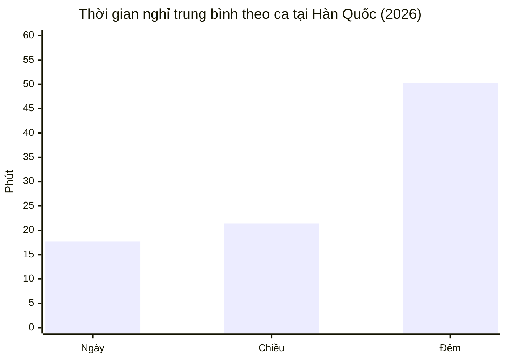
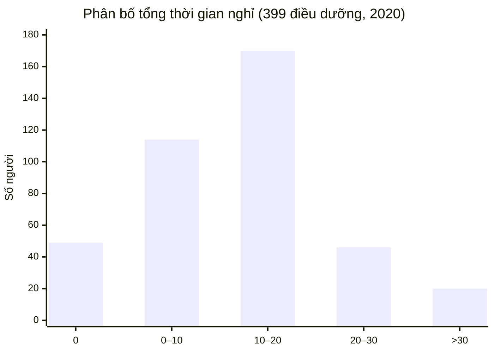
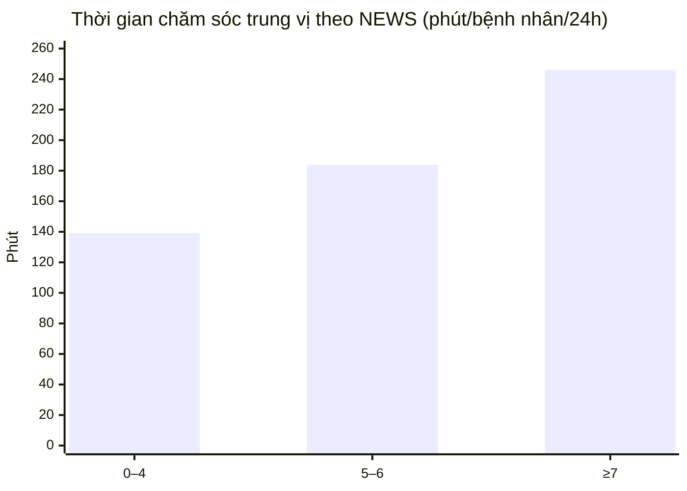
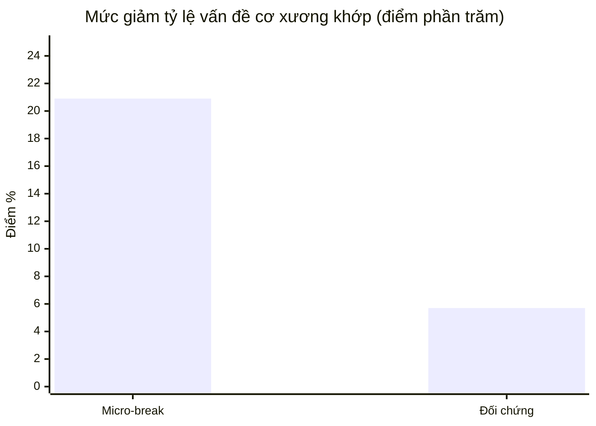
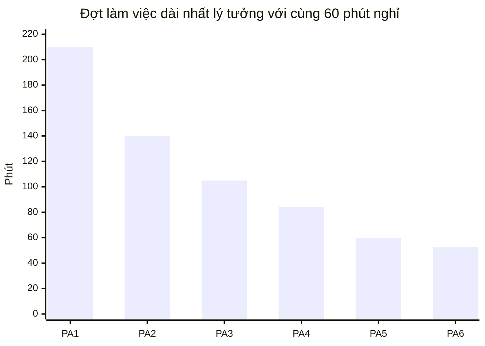
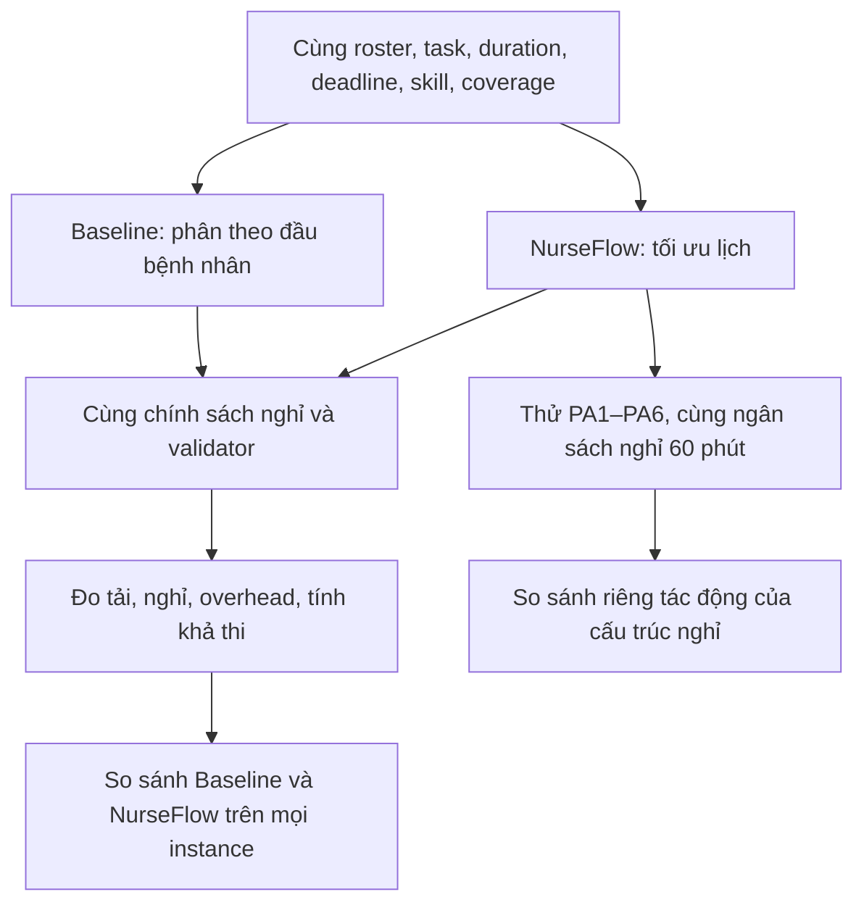

# NurseFlow — Workload, thời gian nghỉ và ngưỡng đánh giá

**Giai đoạn:** CP3 (Checkpoint 3 – mốc kiểm tra tiến độ 3) · **Cập nhật:** 28/11/2026  
**Phạm vi:** Preliminary – xác định threshold cho workload và thời gian nghỉ. Chưa chạy đối chứng trên engine.

## 1. Kết luận và đề xuất

Mục tiêu của phần này là chốt mức workload có thể giao trong một ca mà điều dưỡng vẫn còn đủ thời gian nghỉ. Ngoài tổng số phút nghỉ, tôi muốn kiểm tra xem lịch có tạo được một khoảng nghỉ liền mạch hay chỉ còn những khoảng trống vài phút giữa các task.

| Nội dung | Đề xuất |
|---|---|
| Threshold chính | Ít nhất **30 phút nghỉ liên tục được bảo vệ** cho ca ngày đủ điều kiện; 45 phút cho ca đêm đủ điều kiện |
| Ngưỡng workload theo quỹ thời gian | Ca 8 giờ: tối đa 450 phút (93,75% ca) nếu cần chừa 30 phút nghỉ |
| Mục tiêu mở rộng để thử nghiệm | 60 phút nghỉ, workload tối đa 420 phút (87,5% ca), chưa tính dự phòng riêng |
| Cảnh báo tải theo nhu cầu chăm sóc | Tham chiếu >4 bệnh nhân/RN (Registered Nurse – điều dưỡng đã đăng ký hành nghề) ở khoa Nội–Ngoại (Canada); nhu cầu chăm sóc cao nếu vượt P75 (75th Percentile – phân vị thứ 75) của dữ liệu cùng bối cảnh. Chưa có ngưỡng cường độ chung cho Việt Nam. |
| Kiểu nghỉ ưu tiên thử | **15 + 30 + 15 phút** (Hybrid Break), khi đủ quỹ thời gian và nhân lực thay thế |
| Cách chứng minh | So sánh Baseline và NurseFlow trên cùng dữ liệu; kiểm tra cả tỷ lệ lịch khả thi, nghỉ, workload, deadline và coverage |

Tôi chọn 30/45 phút theo căn cứ pháp lý [1–2], còn 60 phút là mức muốn thử thêm khi điều kiện nhân lực cho phép. Cần thống nhất với nhóm và xác nhận chính sách của bệnh viện trước khi dùng các mốc này trong solver. Metric Agent đã khóa ở CP2 (Checkpoint 2 – mốc kiểm tra tiến độ 2) vẫn giữ nguyên.

## 2. Thực trạng workload và thời gian nghỉ

### 2.1. Workload không chỉ là số lượng bệnh nhân

Nghiên cứu time-and-motion tại Singapore, công bố 08/05/2026 [3], quan sát 48 ca ở ba khoa Nội cấp tính của Alexandra Hospital (04–06/2024). Một số số liệu từ Table 2 và mục Multitasking Load:

| Hoạt động (phút trung bình/ca) | RN ngày | RN đêm | EN ngày | EN đêm |
|---|---:|---:|---:|---:|
| Xử lý thuốc | 88 | 96 | 11 | 4 |
| Đo dấu hiệu sinh tồn | 5 | 17 | 33 | 82 |
| Hỗ trợ vệ sinh | 12 | 33 | 57 | 103 |
| Nhập hồ sơ điện tử | 117 | 92 | 90 | 59 |
| Xem hồ sơ | 104 | 92 | 60 | 53 |
| Bàn giao | 38 | 59 | 16 | 18 |
| Đa nhiệm | 209 | 117 | 152 | 110 |
| **Nghỉ** | **64** | **40** | **93** | **61** |

RN (Registered Nurse – điều dưỡng đã đăng ký hành nghề) và EN (Enrolled Nurse – điều dưỡng thuộc nhóm hành nghề có phạm vi chuyên môn khác RN tại Singapore) có vai trò khác nhau. Số liệu tính theo cả ca; do có đa nhiệm nên không thể cộng các dòng thành tổng workload hoặc dùng chúng làm thời lượng của một task riêng lẻ.

Các nghiên cứu bổ trợ:

| Nguồn | Số liệu đáng chú ý | Ý nghĩa đối với NurseFlow |
|---|---|---|
| Saudi Arabia, time-and-motion 2023 [4], Tables 2–5 | Ca tham chiếu 480 phút: chăm sóc trực tiếp 93, gián tiếp 58, ghi chép 68, trao đổi 24, việc tại khoa 87 phút. Di chuyển 69 phút, trong đó chuyển phòng 36,5 phút; gián đoạn 60 lần, 73 phút. | Tính cả công việc ngoài chăm sóc trực tiếp; nghiên cứu gom task theo vị trí. |
| MatchRN ([Matching Registered Nurse services with changing care demands](https://pubmed.ncbi.nlm.nih.gov/28251690/) – nghiên cứu về bố trí điều dưỡng theo nhu cầu chăm sóc), Thụy Sĩ, dữ liệu 2018 [5] | 703/1.962 (35,83%) bản ghi báo làm thêm ít nhất 30 phút; trung vị 12 phút. | Áp lực thời gian là vấn đề có dữ liệu; không suy ra nguyên nhân hay phút nghỉ từ overtime. |
| Việt Nam, WISN (Workload Indicators of Staffing Need – chỉ số nhu cầu nhân lực theo khối lượng công việc), 2022 [6] | 22 khoa, 4 bệnh viện; khoảng 20–40% thời gian cho hành chính, quản lý. | Không bỏ sót công việc hành chính khi tính tải. |
| Việt Nam, Bệnh viện 19-8, 09/2026 [7] | ICU (Intensive Care Unit – khoa hồi sức tích cực): 361 ngày-người bệnh, NAS (Nursing Activities Score – điểm khối lượng hoạt động điều dưỡng) trung bình 69,8; 29,4% NAS ≥80; 2,7 bệnh nhân/điều dưỡng trong giờ hành chính và 6,4 ngoài giờ. | Số bệnh nhân không phản ánh đầy đủ nhu cầu chăm sóc. Không áp nguyên các ngưỡng ICU cho khoa Nội. |
| Trung Quốc, 10/2026 [8] | 37 RN, 204 giờ quan sát hoạt động thuốc, 2.091 lần gián đoạn (10,25 lần/giờ), trung bình 41,9 giây/lần. | Tham chiếu kịch bản gián đoạn; không áp tần suất này cho toàn bộ ca. |

Điểm tôi chú ý ở bảng Singapore là riêng RN ca ngày đã dành 117 phút nhập hồ sơ và 104 phút xem hồ sơ. Nếu đầu vào của nhóm chỉ có task chăm sóc bệnh nhân thì free time sẽ bị tính dư. Contract CP2 hiện mới tính overhead chuyển phòng (`room_switch_min`), nên cần rà lại các công việc còn thiếu như ghi chép, bàn giao và chuẩn bị. Những việc bắt buộc này vẫn phải làm, dù có gom task tốt đến đâu.

### 2.2. Điều dưỡng thực tế nghỉ bao lâu?

**Hàn Quốc, 21/11/2026 [9].** Nghiên cứu 30 điều dưỡng làm việc theo ba ca, 848 quan sát theo ngày (540 ngày làm việc, 308 ngày nghỉ). Table 2. TB là trung bình (Mean); SD (Standard Deviation) là độ lệch chuẩn.

| Ca | Số quan sát | Thời gian làm việc TB (giờ, ±SD) | Thời gian nghỉ TB (phút, ±SD) | Workload cảm nhận (1–5, TB) |
|---|---:|---:|---:|---:|
| Ngày | 217 | 8,37 ± 0,47 | 17,74 ± 21,66 | 3,15 |
| Chiều | 183 | 8,37 ± 0,61 | 21,37 ± 38,37 | 3,06 |
| Đêm | 140 | 9,92 ± 0,38 | 50,32 ± 46,71 | 2,92 |

Ca đêm có tổng thời gian nghỉ trung bình cao hơn khá nhiều, nhưng độ lệch chuẩn cũng lớn. Bài báo không cho biết nghỉ thành bao nhiêu block nên chưa đánh giá được tính liên tục hay chất lượng nghỉ.

**Hàn Quốc, Min et al. (2020) [10].** Khảo sát 399 điều dưỡng, thời gian nghỉ gồm cả ăn uống trung bình 15,54 ± 11,34 phút/ca.

| Tổng phút nghỉ | Số điều dưỡng | Tỷ lệ |
|---|---:|---:|
| 0 | 49 | 12,3% |
| Trên 0–10 | 114 | 28,6% |
| Trên 10–20 | 170 | 42,6% |
| Trên 20–30 | 46 | 11,5% |
| Trên 30 | 20 | 5,0% |

383/399 (96%) không có khoảng nghỉ thường lệ ngoài giờ ăn. Không xác định riêng số người nghỉ đúng 30 phút hoặc nghỉ liên tục 30 phút.

Khảo sát tại Đức tháng 03/2026 [11] cũng ghi nhận 329 người (61,2% số trả lời hợp lệ) thường xuyên bỏ lỡ giờ nghỉ khi làm trên 6 giờ. Trong nghiên cứu của Rogers (2004) [12], chỉ 2.429/5.211 ca (46,61%) có khoảng nghỉ hoặc ăn uống mà điều dưỡng được giải phóng khỏi trách nhiệm chăm sóc. Những ca còn lại vẫn có thể có nghỉ, nhưng chưa đáp ứng cách định nghĩa này.

Tôi không chọn 15,54 hay 17,74 phút làm threshold. Nếu lấy mức nghỉ thấp đang quan sát được làm chuẩn thì nhóm dễ bỏ qua chính vấn đề muốn giải quyết. Các số liệu này dùng để mô tả thực trạng; baseline phải chạy riêng trên cùng ca và cùng điều kiện với NurseFlow.

### 2.3. Workload theo nhu cầu chăm sóc và nhân lực

Cùng 420 phút làm việc, người chăm sóc nhiều bệnh nhân nặng có thể chịu áp lực cao hơn. Vì vậy, ngoài số phút task, tôi xem thêm tỷ lệ bệnh nhân/RN, nhu cầu chăm sóc và mức độ thiếu nhân lực.

**Canada – Havaei et al. [20].** Bài công bố online 09/06/2025, xuất bản trong số tạp chí năm 2026; phân tích khảo sát năm 2015 của 609 điều dưỡng khoa Nội–Ngoại. Table 4 xác định các điểm chuyển biến từ mô hình hồi quy và đường LOESS (Locally Estimated Scatterplot Smoothing – làm trơn dữ liệu bằng hồi quy cục bộ):

| Kết quả | Điểm chuyển biến (bệnh nhân/điều dưỡng) |
|---|---|
| Chất lượng chăm sóc, an toàn khoa | 4 → 5 |
| Công việc chưa hoàn thành, kiệt sức cảm xúc | 4 → 5 |
| Biến cố bất lợi của bệnh nhân | 3 → 4 |

Tác giả ủng hộ tỷ lệ 1 RN/4 bệnh nhân trong bối cảnh nghiên cứu. Tôi đề xuất dùng trên 4 bệnh nhân/RN làm cảnh báo tham khảo, chưa đưa vào ràng buộc cứng vì đây là kết quả quan sát tại Canada, không phải định mức an toàn chung cho Việt Nam.

**Italy – Zaboli et al. (2026) [21].** Quan sát 392 bệnh nhân trong 24 giờ tại 10 khoa, 5 bệnh viện. NEWS (National Early Warning Score – thang điểm cảnh báo sớm quốc gia) phản ánh mức bất thường sinh lý của bệnh nhân; nhu cầu chăm sóc tăng theo nhóm NEWS.

| NEWS | Phút chăm sóc trung vị/bệnh nhân/24h | Số hoạt động trung vị | Tỷ lệ thời gian so với NEWS 0–4 (tự tính) |
|---|---:|---:|---:|
| 0–4 | 139 | 24 | 1,00 |
| 5–6 | 184 | 27 | 1,32 |
| ≥7 | 246 | 36 | 1,77 |

Bài này dùng phân vị 75 (P75) để đánh dấu bệnh nhân có nhu cầu chăm sóc cao. Điểm đáng dùng cho nhóm là tỷ lệ 1,00 : 1,32 : 1,77: có thể tham khảo khi sinh kịch bản bệnh nhân với mức nhu cầu khác nhau. Chưa có dữ liệu cá nhân công khai để tính P75 của nhóm. Cũng cần tránh lấy số phút chăm sóc trong 24 giờ gán thẳng cho ca 8 giờ, hoặc nhân thêm trọng số khi task đã phản ánh acuity. P75 ở đây phân loại bệnh nhân, không phân loại điều dưỡng quá tải.

**Phần Lan – RAFAELA (tên hệ thống phân loại nhu cầu chăm sóc điều dưỡng), Fagerström et al. (2018) [22].** Khi tải OPC/nurse (Oulu Patient Classification – điểm nhu cầu chăm sóc tính trên mỗi điều dưỡng) cao hơn mức tối ưu riêng của khoa, odds sự cố an toàn tăng (OR 1,24; CI 95% 1,08–1,42), odds tử vong tăng (OR 1,43; CI 95% 1,18–1,73). OR (Odds Ratio) là tỷ số chênh; CI (Confidence Interval) là khoảng tin cậy. Đây là mối liên hệ quan sát. Không có một con số OPC chung để chuyển thẳng thành phút workload của NurseFlow.

**Việt Nam – WISN [6].** WISN ratio = nhân lực hiện có / nhân lực cần thiết. Mốc 1 thể hiện đáp ứng đúng nhu cầu tính toán; dưới 1 là thiếu nhân lực. Nghiên cứu ghi nhận các khoa thiếu 1–2 điều dưỡng có tỷ lệ 0,88–0,95, và một khoa ở Cần Thơ thiếu 5 điều dưỡng với tỷ lệ 0,78. Đây là chỉ số hoạch định nhân lực cấp khoa, không phải ngưỡng cá nhân theo ca.

**Italy – Ivziku et al. (09/2026) [23].** 502 bản ghi ca tại 16 khoa Nội–Ngoại, 6 bệnh viện: trung bình 6,5 hoạt động chăm sóc bị bỏ sót/ca; 150/502 (29,9%) ca không báo bỏ sót. Bảy chỉ số workload xét chung có liên hệ với missed care (p = 0,002), nhưng từng chỉ số không còn ý nghĩa sau hiệu chỉnh nhiều kiểm định. Vì vậy, nhóm nên kiểm tra đủ task bắt buộc và deadline, không tạo thêm free time bằng cách bỏ việc. Task đúng hạn trên lịch không đồng nghĩa chăm sóc thực tế đã hoàn thành.

Qua các bài trên, tôi chưa thấy căn cứ để gọi workload trên 87,5% là quá tải lâm sàng. Mốc này chỉ có nghĩa là không còn đủ quỹ cho Hybrid Break 60 phút trong ca 8 giờ. Tôi sẽ giữ riêng ba cấp đánh giá: nhu cầu của bệnh nhân, tải của điều dưỡng và tình trạng nhân lực của khoa.

### 2.4. MatchRN: số liệu thực tế để kiểm tra tải cảm nhận

Dataset công khai [5] và bài nghiên cứu đi kèm của Martins et al. (2025) [24] gồm khảo sát 1.962 RN tại 26 bệnh viện cấp tính ở Thụy Sĩ (2018). Bài báo ghi nhận:

| Chỉ số | Kết quả đã công bố |
|---|---:|
| Điểm NASA-TLX tổng (National Aeronautics and Space Administration Task Load Index – thang đo khối lượng công việc cảm nhận, 6–120 điểm) | 66,5 ± 17,2 |
| Báo làm thêm trong ca gần nhất | 1.146/1.962 (58,4%) |
| Làm thêm ≥30 phút | 703/1.962 (35,8%) |
| Làm thêm ≥30 phút, ca ngày | 606 (39,3%) |
| Làm thêm ≥30 phút, ca đêm | 97 (23,1%) |

Trong mô hình hiệu chỉnh của tác giả, làm thêm ở ca gần nhất liên hệ với điểm NASA-TLX cao hơn 8,8 điểm (CI 95% 7,2–10,4); nhóm nhân lực thấp (tỷ lệ bệnh nhân/nhân lực quan sát so với kỳ vọng O/E ≥1,24) cao hơn 3,1 điểm (CI 95% 0,5–5,6) so với nhóm nhân lực cao. O/E (Observed/Expected – tỷ số giữa giá trị quan sát và giá trị kỳ vọng) được dùng để phân nhóm theo mô hình nhân lực của nghiên cứu, không phải WISN hay ngưỡng quá tải phổ quát.

Bài báo chưa xác định được điểm NASA-TLX nào là mức tải tới hạn. Khi có CSV (Comma-Separated Values – tệp dữ liệu phân tách bằng dấu phẩy), tôi muốn thử chia nhóm theo P75 của NASA-TLX rồi xem tỷ lệ làm thêm ≥30 phút khác nhau ra sao, tách theo ca/khoa nếu đủ mẫu. Cố định P75 trên tập tham chiếu trước khi kiểm tra tập khác; không ước lượng P75 từ trung bình và SD khi chưa biết phân bố. Mốc overtime 30 phút lấy theo cách phân tích của bài, không phải ngưỡng pháp lý về giờ nghỉ.

**Việc còn thiếu:** Zenodo v1.0.0 có CSV và codebook, nhưng lần tải trước gặp lỗi kết nối. Số liệu trên lấy từ bài báo và phân tích sẵn của nhóm, chưa tính lại P75 hay kiểm định độc lập. Dataset cũng không đủ thông tin để suy free time trực tiếp từ overtime.

## 3. Các kiểu nghỉ thực tế và bằng chứng hiệu quả

### 3.1. Các mô hình đã được ghi nhận tại bệnh viện

| Mô hình | Cấu trúc | Nguồn và loại bằng chứng |
|---|---|---|
| Nghỉ tập trung | 1 × 30 phút/ca 8 giờ | Saudi Arabia, 10/11/2026 [13], chính sách của hai bệnh viện giảng dạy tại Riyadh |
| Nghỉ kết hợp (Hybrid) | 1 × 30 phút ăn + 2 × 15 phút nghỉ/ca 12 giờ | Cùng nghiên cứu [13], chính sách; trưởng ca sắp xếp theo hoạt động khoa |
| Micro-break có cấu trúc | 2–3 phút mỗi 30 phút trong thủ thuật kéo dài trên 60 phút | Trung Quốc, 2025 [14], can thiệp có nhóm đối chứng ở phòng mổ |
| Ngủ ngắn có kế hoạch trong ca đêm | 15–30 phút được xem là dễ bố trí hơn | Phần Lan, 2026 [15], ý kiến điều dưỡng và quản lý ICU, chưa phải kết quả can thiệp |

Nghiên cứu Saudi Arabia phỏng vấn 22 RN tại hai bệnh viện trong 08–11/2025. Cả hai nơi đều không có nhân lực chuyên trách thay người nghỉ, nên dù đã quy định số phút nghỉ, việc nghỉ đủ vẫn phụ thuộc vào workload và cách trưởng ca điều phối.

### 3.2. Hiệu quả của nghỉ ngắn

Tổng quan và phân tích gộp của Albulescu et al. (2022) [16] về micro-break tối đa 10 phút cho thấy:

| Kết quả | Effect size (d) | n trong phân tích | Ý nghĩa thống kê |
|---|---:|---:|---|
| Tăng sức sống/năng lượng | 0,36 | 913 | p < 0,001 |
| Giảm mệt mỏi | 0,35 | 803 | p < 0,001 |
| Cải thiện hiệu suất chung | 0,16 | 1.132 | p = 0,116 (không có ý nghĩa thống kê, theo abstract) |

`n` là cỡ mẫu; `p` (p-value) là giá trị p trong kiểm định thống kê. `d` là kích thước hiệu ứng chuẩn hóa, không phải tỷ lệ phần trăm tăng năng suất. Nghiên cứu gồm nhiều đối tượng ngoài điều dưỡng; thời lượng micro-break dài hơn có liên hệ với hiệu suất tốt hơn trong phân tích hồi quy gộp.

Nghiên cứu Trung Quốc (2025) [14] theo dõi 6 tháng tại 5 bệnh viện, 178 điều dưỡng phòng mổ (91 can thiệp, 87 đối chứng; không phân nhóm ngẫu nhiên):

| Mức giảm sau 6 tháng | Micro-break | Đối chứng |
|---|---:|---:|
| Tỷ lệ vấn đề cơ xương khớp (điểm %) | 20,9 | 5,7 |
| Điểm căng thẳng cảm nhận | 4,4 | 0,6 |
| Điểm kiệt sức cảm xúc | 6,3 | 0,8 |

Kết quả khiến tôi không muốn loại bỏ các khoảng nghỉ ngắn khi gom task. Chúng có thể giúp giảm căng thẳng và mệt mỏi, nhưng nghiên cứu ở phòng mổ chưa cho biết Hybrid hay nghỉ tập trung giúp điều dưỡng khoa Nội hoàn thành task nhanh hơn.

### 3.3. Nghỉ nhưng vẫn phải trực

Nghiên cứu Sagherian et al. (2023) [17–18] cho thấy nghỉ có thể bị gián đoạn; khả năng tách khỏi công việc và workload là yếu tố quan trọng khi xem xét mệt mỏi. Tổng quan mới của Turan (11/2026) [19] gộp 9 nghiên cứu quan sát, 7.027 điều dưỡng, tương quan chung r = 0,288 (p < 0,001). Phân tích riêng về mệt mỏi, hài lòng công việc và an toàn người bệnh chưa đạt ý nghĩa thống kê; nhóm kết quả liên quan nghỉ việc có ý nghĩa. Chỉ sử dụng kết quả abstract.

Với NurseFlow, tôi nghĩ cần tính cả việc ai sẽ phụ trách bệnh nhân khi một người nghỉ. Nếu chỉ tạo được block 30 phút trên lịch nhưng điều dưỡng vẫn phải nghe điện thoại hoặc xử lý việc phát sinh, chất lượng nghỉ chưa chắc được cải thiện. Các nghiên cứu hiện có chưa đủ để chọn một kiểu nghỉ có năng suất cao nhất.

## 4. So sánh sáu phương án nghỉ cho NurseFlow

Tôi thử chia cùng 60 phút nghỉ theo sáu cách (PA1–PA6: phương án 1 đến phương án 6) trong ca 480 phút. Giữ nguyên 420 phút công việc, chia đều các đợt làm việc, chưa tính gián đoạn hay overhead chuyển giao. Bảng dưới là phép tính minh họa trước khi chạy solver.

| Phương án | Cách chia (phút) | Số block | Nghỉ dài nhất | Làm liên tục tối đa lý tưởng | Đạt nghỉ chính ≥30 phút? | Nhận xét thiết kế |
|---|---|---:|---:|---:|---|---|
| PA1 – Tập trung | 60 | 1 | 60 | 210 | Có | Ít lần điều phối nghỉ, nhưng làm liên tục dài |
| PA2 – Chia đôi | 30 + 30 | 2 | 30 | 140 | Có | Tương đối đơn giản, hai khoảng hồi phục dài |
| **PA3 – Hybrid** | **15 + 30 + 15** | **3** | **30** | **105** | **Có** | **Ưu tiên thử nghiệm: có nghỉ chính và nghỉ bổ sung** |
| PA4 – Chia nhỏ | 4 × 15 | 4 | 15 | 84 | Không | Nghỉ thường xuyên nhưng thiếu block chính |
| PA5 – Phân mảnh | 6 × 10 | 6 | 10 | 60 | Không | Nhiều lần bố trí nghỉ, thiếu block chính |
| PA6 – Micro-break kết hợp | 30 + 6 × 5 | 7 | 30 | 52,5 | Có | Có thể giảm đợt làm liên tục nhưng nhiều lần điều phối |

Công thức làm liên tục tối đa trong mô hình chia đều: `420 / (số block nghỉ + 1)`. Đây là cận dưới lý tưởng của đợt làm việc dài nhất, không phải giá trị đo thực tế.

### Phương án đề xuất: PA3 – Phase-Based Hybrid Break

Nếu chỉ nhìn vào thời gian làm liên tục, PA6 tốt hơn PA3. Nhưng 7 block nghỉ thay vì 3 sẽ khó điều phối hơn khi phải bố trí người thay. PA3 giảm đợt làm việc dài nhất từ 210 xuống 105 phút so với PA1 trong mô hình chia đều (giảm 50%, không phải tăng năng suất 50%). Chưa có số liệu về chi phí chuyển giao nên chưa chấm điểm chi phí cho các phương án.

Tôi sẽ thử PA3 trước, sau đó so với PA2 (ít lần điều phối) và PA6 (nghỉ thường xuyên hơn). Cách chia 15 + 30 + 15 có tiền lệ ở ca 12 giờ [13]; áp dụng vào ca 8 giờ là đề xuất thử nghiệm, không phải chính sách gốc. Nếu ca chỉ còn đủ 30 phút, ưu tiên block chính 30 phút. Nếu vẫn không bố trí được theo chính sách, báo thiếu nguồn lực để trưởng ca xem lại thay vì tự cắt nghỉ hay bỏ coverage.

## 5. Threshold và cách tính từ free time

### 5.1. Cách tính workload và free time

| Đại lượng | Cách hiểu |
|---|---|
| `A` – available minutes | Tổng phút khả dụng của điều dưỡng trong ca, trước khi trừ nghỉ |
| `W` – workload minutes | Tổng thời gian task và transition/overhead đã mô hình hóa; không tính trùng |
| `F = A - W` – free time | Thời gian còn lại, bao gồm cả thời gian trực dự phòng và nghỉ |
| `P` – protected break minutes | Tổng phút nghỉ đã bố trí người phụ trách thay và đủ coverage |
| `L` – longest protected break | Độ dài block nghỉ được bảo vệ dài nhất |
| `R` – reserve minutes | Thời gian dự phòng cần giữ ngoài giờ nghỉ, nếu chính sách yêu cầu |

Gọi `B` (Break minutes) là số phút nghỉ cần chừa. Khi đó `F ≥ B + R`, tương đương `W ≤ A - B - R`. Có đủ số phút mới là bước đầu; còn phải xếp được block nghỉ liền mạch và người phụ trách thay. CP2 hiện đếm cả người đang làm task trong coverage, nên chưa biết họ có thực sự rảnh để nhận trách nhiệm thay hay không. Muốn đo số phút nghỉ thực tế cần nhật ký thực hiện.

### 5.2. Bảng threshold đề xuất

Giả định ca 8 giờ, `A = 480`, `R = 0` chỉ để minh họa. Điều 109 Bộ luật Lao động và Điều 64 Nghị định 145/2020/NĐ-CP [1–2] là căn cứ tham chiếu; 45 phút áp dụng khi làm từ 6 giờ/ngày, có ít nhất 3 giờ trong khung ban đêm. Xác nhận chế độ làm việc thực tế của bệnh viện trước khi cấu hình.

| Metric | Ca ngày – mốc chính | Ca đêm đủ điều kiện | Mục tiêu Hybrid ca ngày |
|---|---:|---:|---:|
| Free time tối thiểu | ≥30 phút | ≥45 phút | ≥60 phút |
| Block nghỉ liên tục được bảo vệ | ≥30 phút | ≥45 phút | ≥30 phút |
| Tổng nghỉ được bảo vệ | ≥30 phút | ≥45 phút | ≥60 phút |
| Workload tối đa | ≤450 phút | ≤435 phút | ≤420 phút |
| Workload / thời lượng khả dụng | ≤93,75% | ≤90,625% | ≤87,5% |
| Tỷ lệ điều dưỡng cần nghỉ đạt chính sách | 100% trên lịch hợp lệ | 100% trên lịch hợp lệ | Mục tiêu 100% |
| Số block nghỉ | Theo chính sách | Theo chính sách | 3 (15 + 30 + 15) |
| Đợt làm việc liên tục dài nhất | Đo và so sánh | Đo và so sánh | Hướng tới 105–120 phút, mốc thử nghiệm |
| Vi phạm kỹ năng/coverage/deadline bắt buộc | 0 | 0 | 0 |

Ví dụ: workload 440 phút thì free time là 40 phút. Đủ quỹ thời gian cho 30 phút nghỉ nhưng nếu chia thành 4 block 10 phút, không đạt yêu cầu nghỉ liên tục. Nếu cần giữ thêm 20 phút dự phòng, workload tối đa để chừa 30 phút nghỉ là 430 phút, không phải 450.

Lưu ý khi tích hợp: 93,75%, 90,625% và 87,5% đều tính trên thời lượng khả dụng trước khi trừ nghỉ. Engine đang dùng `workload / max_capacity_min`; nếu capacity đã trừ nghỉ thì không trừ thêm. Giữ nguyên fixture CP2 (120 phút, nghỉ 15 phút) để kiểm hồi quy.

### 5.3. Bảng ngưỡng bàn giao cho nhóm

| Tham số/metric | Ngưỡng hoặc quy tắc | Cách sử dụng |
|---|---|---|
| `min_continuous_break_min` | 30 ngày / 45 đêm đủ điều kiện [1–2] | Ràng buộc theo chính sách đã xác nhận |
| `max_workload_for_min_break_min` | `A - B - R` | Điều kiện cần về quỹ phút, không trừ nghỉ hai lần |
| `target_total_break_min` | 60 phút (ca ngày thử nghiệm) | Mục tiêu mềm, không phải chuẩn bệnh viện |
| `target_break_pattern` | `[15, 30, 15]` | Phương án thử; cần hỗ trợ nhiều block |
| `target_max_continuous_work_min` | 120 phút | Mục tiêu mềm thử nghiệm, không phải ngưỡng sức khỏe |
| `patient_count_warning` | >4 bệnh nhân/RN [20] | Cờ tham chiếu khoa Nội–Ngoại, không ép cứng |
| `high_care_demand` | Thời gian chăm sóc >P75 trong dữ liệu cùng bối cảnh [21] | Cờ nhu cầu cao cấp bệnh nhân; chưa có giá trị phút cục bộ |
| `high_perceived_workload` | NASA-TLX >P75 mẫu tham chiếu (đề xuất) [24] | Phân tích survey; chưa tính P75 |
| `staffing_sufficiency` | WISN ≥1 [6] | Tham chiếu hoạch định cấp khoa, không dùng trực tiếp làm capacity ca |
| `mandatory_task_violations` | 0 | Ràng buộc cứng trên lịch |

Bảng này để trao đổi với Khoa (contract) và Lam (solver), chưa phải schema hiện tại. Hai ngưỡng có thể tính ngay là quỹ thời gian và nghỉ liên tục. Các cảnh báo cường độ cần dữ liệu và loại khoa phù hợp trước khi dùng.

### 5.4. Kiểm tra công thức ở sát ngưỡng

Kiểm tra hai mốc 420 và 450 phút với ca 480 phút, reserve bằng 0 và giả sử W đã gồm đủ công việc. Đây là các giá trị tự tạo để thử công thức ở sát biên.

| W (phút) | F (phút) | Đủ quỹ 30 phút | Đủ quỹ 60 phút |
|---:|---:|---|---|
| 400 | 80 | Có | Có |
| 419 | 61 | Có | Có |
| 420 | 60 | Có | Có |
| 421 | 59 | Có | Không |
| 449 | 31 | Có | Không |
| 450 | 30 | Có | Không |
| 451 | 29 | Không | Không |
| 470 | 10 | Không | Không |

Nếu giữ thêm 20 phút dự phòng (`R=20`), hai mốc của ca ngày giảm còn 430 và 400 phút. Với ca 12 giờ (720 phút), nghỉ đêm 45 phút và dự phòng 20 phút, W tối đa là 655 phút. Bảng mới kiểm tra quỹ phút; tính liên tục và coverage phải được kiểm bằng lịch.

## 6. Kiểm chứng phương án nghỉ và hiệu quả của NurseFlow

### 6.1. Thiết kế thử nghiệm

Tôi muốn chạy riêng hai bài test: một bài so Baseline với NurseFlow (cùng chính sách nghỉ), một bài so các kiểu nghỉ (cùng engine, nhân lực và 60 phút nghỉ). Nên có ca tải thấp, vừa, cao, thiếu người và dồn deadline. Ca nào không xếp được hoặc chưa xác định cũng phải ghi vào kết quả.

| Chỉ số | Công thức/cách chấm | Hướng cải thiện |
|---|---|---|
| Tỷ lệ lịch hợp lệ | Số instance qua validator / toàn bộ instance | Tăng |
| Break Fulfillment Rate | Số người đạt đủ chính sách nghỉ / số người thuộc diện cần nghỉ (báo trên lịch hợp lệ, ghi rõ mẫu số) | Tăng |
| Biên nghỉ liên tục | `L - B_continuous` (phút) | ≥0; cao hơn nếu phù hợp |
| Free time margin | `F - B - R` (phút) | ≥0 |
| Đợt làm liên tục dài nhất | Khoảng làm việc/duy trì trách nhiệm giữa các block nghỉ được bảo vệ; gồm đầu và cuối ca | Giảm |
| Workload imbalance | CV (Coefficient of Variation – hệ số biến thiên) của utilization theo capacity, theo định nghĩa engine | Giảm |
| Peak utilization, overhead | Giá trị cao nhất và tổng phút thao tác phụ | Giảm hoặc không tăng |
| Task bắt buộc, deadline, skill, coverage | Validator; không chấp nhận bỏ task hoặc vi phạm ràng buộc | 100% task đúng hạn theo lịch; 0 vi phạm |

Có một điểm dễ làm sai khi đánh giá: nếu cả hai cách đều bắt buộc nghỉ 30 phút thì lịch nào qua validator cũng đã đạt mốc đó. Khi ấy, cần xem phương án nào xếp được nhiều ca hợp lệ hơn trên toàn bộ bộ test, thay vì chỉ báo tỷ lệ nghỉ đủ trên các ca đã qua.

### 6.2. Việc còn lại

Chưa có kết quả chạy Baseline và NurseFlow. Khi chạy, lưu thêm free time thấp nhất và block nghỉ dài nhất của người có ít thời gian nghỉ nhất, bên cạnh các metric ở bảng trên.

**Việc cần thống nhất với Lam:** contract CP2 mới hỗ trợ một block/người. Muốn test PA2–PA6 cần sửa `break_policy` và validator để nhận nhiều block, đồng thời giữ fixture hồi quy. Nếu chưa mô hình hóa người thay và reserve, kết quả chỉ nên gọi là giờ nghỉ được xếp trên lịch, chưa phải protected break đã xác nhận.

Chưa có dữ liệu nhật ký từng block nghỉ ở khoa mục tiêu tại Việt Nam, cũng chưa tìm được nghiên cứu đối chứng cả sáu cách nghỉ. Vì vậy, tôi muốn chốt threshold và cách chấm trước khi chạy test. Mô phỏng có thể cho thấy lịch nào khả thi hơn; nếu muốn kết luận về năng suất hoặc sai sót thực tế, cần theo dõi thêm việc thực hiện task và mức mệt mỏi của điều dưỡng.

## 7. Tài liệu tham khảo

DOI (Digital Object Identifier) là mã định danh tài liệu số. Các đường dẫn PMC (PubMed Central) trỏ tới kho bài báo toàn văn.

1. Bộ luật Lao động, Điều 109. [Văn bản hợp nhất 18/VBHN-VPQH năm 2026](https://thuvienphapluat.vn/van-ban/Lao-dong-Tien-luong/Van-ban-hop-nhat-18-VBHN-VPQH-2026-Bo-luat-lao-dong-695336.aspx).
2. Nghị định 145/2020/NĐ-CP, Điều 64. [Nội dung văn bản](https://thuvienphapluat.vn/van-ban/Lao-dong-Tien-luong/Nghi-dinh-145-2020-ND-CP-huong-dan-Bo-luat-Lao-dong-ve-dieu-kien-lao-dong-quan-he-lao-dong-459400.aspx).
3. Sumner et al. (2026). *Implications for Virtual Nursing Role Development in Acute Nursing Care: 24-Hour Time-and-Motion Study*. [Table 2, Multitasking Load](https://nursing.jmir.org/2026/1/e87930).
4. Al-Moteri et al. (2023). *The Road to Developing Standard Time for Efficient Nursing Care: A Time and Motion Analysis*. [Tables 2–5](https://pmc.ncbi.nlm.nih.gov/articles/PMC10418769/).
5. Martins, Musy & Simon, MatchRN v1.0.0. [Dataset](https://zenodo.org/records/15248072); [phép đếm của nhóm](https://github.com/lit1numyt/K5-Day15-L3B-ToiYeuVingroup/blob/a3c025a28a39decbf25954bc7f29acb87463580f/evidence/data-mining.md), [contract CP2](https://github.com/lit1numyt/K5-Day15-L3B-ToiYeuVingroup/blob/a3c025a28a39decbf25954bc7f29acb87463580f/docs/cp2-contract.md). Kết quả MatchRN lấy từ repo, chưa chạy lại script.
6. (2022). *Applying the workload indicators of staffing needs method in nursing health workforce planning: evidences from four hospitals in Vietnam*. [Toàn văn](https://doi.org/10.1186/s12960-021-00668-y).
7. Vũ Thị Hằng, Nguyễn Minh Hoàng (2026). *Đánh giá cường độ chăm sóc điều dưỡng bằng thang điểm Nursing Activities Score và tỷ lệ người bệnh/điều dưỡng theo ca tại Bệnh viện 19-8 Bộ Công an*. [Abstract](https://tapchiyhcd.vn/index.php/yhcd/en/article/view/6416).
8. Wang et al. (2026). *How do nurses respond to interruptions during medication administration? A time-and-motion study in a Chinese hospital*. [BMC Nursing](https://link.springer.com/article/10.1186/s12912-026-05513-y).
9. (2026). *Work Schedules and Wearable-Derived Sleep Duration and Timing Among Shift Work Nurses*. [Table 2](https://www.mdpi.com/2227-9032/14/23/4009).
10. Min et al. (2020). *Association between nurses' breaks, missed nursing care and patient safety in Korean hospitals*. [DOI](https://doi.org/10.1111/jonm.12831); [Table 1](https://www.researchgate.net/publication/334721904_Association_between_nurses%27_breaks_missed_nursing_care_and_patient_safety_in_Korean_hospitals).
11. (2026). *The impact of working time conditions on nurses’ private life: a cross-sectional study on spillover effects and structural factors for recovery*. [BMC Nursing](https://link.springer.com/article/10.1186/s12912-026-04519-w).
12. Rogers, Hwang & Scott (2004). *The effects of work breaks on staff nurse performance*. [Abstract](https://pubmed.ncbi.nlm.nih.gov/15586072/).
13. Almutairy et al. (2026). *Early-Career Nurses’ Experiences of Micro-Breaks During Long Hospital Shifts in Saudi Arabia: A Qualitative Study*. [Mục 2.2–2.3](https://www.mdpi.com/2227-9032/14/22/3852).
14. (2025). *Long-Term Effects of Structured Microbreak Interventions on Musculoskeletal Health, Psychological Wellbeing, and Patient Safety Among Operating Room Nurses: A Multicenter Longitudinal Cohort Study*. [Toàn văn](https://pmc.ncbi.nlm.nih.gov/articles/PMC12523640/).
15. (2026). *Silent practices becoming norms: planned napping for nurses during intensive care night shifts – a focus group study*. [Toàn văn](https://pmc.ncbi.nlm.nih.gov/articles/PMC12924770/).
16. Albulescu et al. (2022). *Give me a break! A systematic review and meta-analysis on the efficacy of micro-breaks for increasing well-being and performance*. [Toàn văn](https://pmc.ncbi.nlm.nih.gov/articles/PMC9432722/); [abstract](https://pubmed.ncbi.nlm.nih.gov/36044424/).
17. Sagherian, Cho & Steege (2023). *The State of Rest Break Practices Among 12-Hour Shift Hospital Nurses in the United States*. [Abstract](https://pubmed.ncbi.nlm.nih.gov/37098868/).
18. Sagherian et al. (2023). *Nurses’ Rest Breaks and Fatigue: The Roles of Psychological Detachment and Workload*. [DOI](https://doi.org/10.1177/01939459231189787).
19. Turan (2026). *Nurses' Rest Breaks and Their Associations With Job Satisfaction, Turnover-Related Outcomes, Fatigue, and Patient Safety: A Meta-Analysis of Observational Studies*. [Abstract](https://pubmed.ncbi.nlm.nih.gov/43016048/).

20. Havaei et al. (online 2025, số tạp chí 2026). *Beyond the Ratios: Evidence for Optimal Minimum Nurse-Patient-Ratios in Medical-Surgical Settings*. [Toàn văn, Table 4](https://doi.org/10.1111/jan.17104).
21. Zaboli et al. (2026). *Association Between the National Early Warning Score and Nursing Workload in Acute Hospital Wards: A Multicentre Observational Study*. [Abstract và tài liệu bổ sung](https://onlinelibrary.wiley.com/doi/10.1111/jocn.70588).
22. Fagerström, Kinnunen & Saarela (2018). *Nursing workload, patient safety incidents and mortality: an observational study from Finland*. [Abstract](https://pubmed.ncbi.nlm.nih.gov/29691240/); [DOI](https://doi.org/10.1136/bmjopen-2017-016367).
23. Ivziku et al. (2026). *Patient-Count and Perceived Workload Associations With Missed Nursing Care: A Multicenter Repeated-Measures Study*. [Toàn văn, Results và Table 1](https://pmc.ncbi.nlm.nih.gov/articles/PMC13551504/).
24. Martins et al. (2025). *Nurse shift patterns, staffing and their association with perceived workload: Sequence analysis of multicentre data*. [Toàn văn, mục 3.1, 3.3–3.4 và Discussion](https://pmc.ncbi.nlm.nih.gov/articles/PMC12538485/); [dataset v1.0.0](https://zenodo.org/records/15248072).

Ghi chú: số liệu trong báo cáo đến từ các nghiên cứu và mẫu khác nhau, không gộp thành một dataset chung. Đây là tổng hợp tài liệu có chọn lọc; chưa thu thập dữ liệu cá nhân, chạy lại EDA (Exploratory Data Analysis – phân tích dữ liệu khám phá) trên MatchRN hay thực nghiệm engine.
